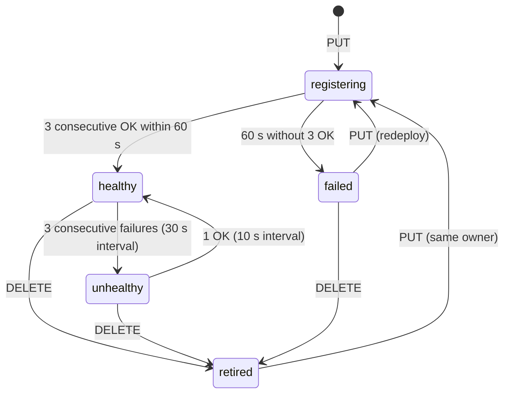

# 03 — Registry

Implementation-level specification. Overview: `../09-component-design.md` §3. The registry runs **inside the gateway process** (`02-gateway.md`); this file specifies its data, API, state machine and operations. ⚑ = confirm at implementation.

## 1. Purpose

The registry is the platform's source of truth for "which apps exist, who may see them, are they healthy". Three consumers read it: `/auth/verify` (authorization), the portal UI (menu), and the Traefik HTTP-provider endpoint (routing). It has exactly one writer path: the deploy tooling.

## 2. Storage

SQLite file `/var/lib/portal/registry.db` (host: `/var/lib/portal/<env>/registry.db`), WAL mode, foreign keys on, one connection for writes (serialised with `BEGIN IMMEDIATE`), short-lived read connections. At ≤ 10 apps and a handful of writes per day, nothing larger is justified (P-04).

### 2.1 Schema (migration 1)

```sql
PRAGMA journal_mode = WAL;
PRAGMA foreign_keys = ON;

CREATE TABLE apps (
  slug                 TEXT PRIMARY KEY
                         CHECK (length(slug) BETWEEN 3 AND 31
                                AND slug GLOB '[a-z]*'
                                AND NOT slug GLOB '*[^a-z0-9-]*'),
  manifest_json        TEXT    NOT NULL CHECK (json_valid(manifest_json)),
  version              TEXT    NOT NULL,
  status               TEXT    NOT NULL
                         CHECK (status IN ('registering','healthy','unhealthy','failed','retired')),
  owner_repo           TEXT    NOT NULL,
  image_digest         TEXT    NOT NULL CHECK (image_digest GLOB 'sha256:*'),
  registered_at        TEXT    NOT NULL,           -- ISO-8601 UTC
  updated_at           TEXT    NOT NULL,
  retired_at           TEXT,
  consecutive_failures INTEGER NOT NULL DEFAULT 0,
  last_probe_at        TEXT,
  last_probe_ok        INTEGER CHECK (last_probe_ok IN (0,1))
);

CREATE TABLE deployments (
  id              INTEGER PRIMARY KEY AUTOINCREMENT,
  slug            TEXT    NOT NULL REFERENCES apps(slug),
  image_digest    TEXT    NOT NULL,
  previous_digest TEXT,
  version         TEXT    NOT NULL,
  deployed_at     TEXT    NOT NULL,
  deployed_by     TEXT    NOT NULL,
  result          TEXT    NOT NULL CHECK (result IN ('success','failed','rolled_back')),
  detail          TEXT
);
CREATE INDEX idx_deployments_slug ON deployments (slug, id DESC);

CREATE TABLE audit (
  id     INTEGER PRIMARY KEY AUTOINCREMENT,
  ts     TEXT NOT NULL,
  actor  TEXT NOT NULL,
  action TEXT NOT NULL,
  slug   TEXT,
  detail TEXT
);
CREATE TRIGGER audit_no_update BEFORE UPDATE ON audit
  BEGIN SELECT RAISE(ABORT, 'audit is append-only'); END;
CREATE TRIGGER audit_no_delete BEFORE DELETE ON audit
  BEGIN SELECT RAISE(ABORT, 'audit is append-only'); END;

PRAGMA user_version = 1;
```

Migrations: ordered files `migrations/0001_init.sql, 0002_….sql`; at start the service reads `PRAGMA user_version` and applies the missing ones inside one transaction each. A newer database than the code → refuse to start (no silent downgrade).

### 2.2 In-memory snapshot

After every committed write and every probe result change, the registry builds an immutable `Snapshot` (dict `slug → AppView{slug,name,category,menu,roles,adapters,claims,status,version}`) and swaps one reference atomically. Readers never lock. A `snapshot.version` integer increments on each swap and is logged.

## 3. Manifest schema (contract #2)

Single file `manifest.schema.json` in the platform repository; **the same file** is used by the pipeline's manifest stage, the registry, and the SDK's start-up self-check. The schema is in `../09-component-design.md` §3.2; additions made here:

| Field | Rule |
|---|---|
| `slug` | pattern as above; **not** in the reserved list `[_portal, admin, api, auth, static, apps, portal, adapters, gateway, traefik, redis, registry, health, healthz, login, logout, oidc]` |
| `name` | 1–60 chars, no control characters |
| `category` | enum `Studium`, `Verwaltung`, `Kommunikation`, `Sonstiges` |
| `menu.label` | 1–40 chars; `menu.icon` from the allow-list |
| `roles` | ≥ 1 item; each must exist in the platform role vocabulary (`roles.yml` + grants) — checked at registration, not only by pattern |
| `adapters` | each `system:operation` must exist in the adapters' OpenAPI (`05-adapter-service.md`) — checked at registration |
| `claims` | only `email` today |
| `version` | semver `MAJOR.MINOR.PATCH` |

DNS aliases are `app-<slug>` (R25), so reserved slugs protect URL space, not container names.

## 4. REST contract

All JSON; errors are `application/problem+json` with a stable `type` URN. Auth: `Authorization: Bearer <registrar token>` (constant-time comparison). Reachable only on the gateway's main listener (`ingress` network); not routed by Traefik; used through `gateway-cli` (R24, `09-pipeline-and-deploy.md`).

| Call | Request | Success | Errors |
|---|---|---|---|
| `PUT /registry/apps/{slug}` | `{manifest, image_digest, owner_repo, deployed_by, rollback?: bool}` | **202** `{slug, status:"registering", version}` | 400 `manifest-invalid` (list of JSON-pointer + message), 401 `unauthorized`, 403 `owner-mismatch`, 409 `slug-cooldown`, 422 `version-downgrade`, 422 `unknown-role`, 422 `unknown-adapter-scope`, 409 `deploy-in-progress` |
| `GET /registry/apps/{slug}` | — | 200 full record + last 5 deployments | 404 |
| `GET /registry/apps` | — | 200 list (slug, status, version, last_probe) | — |
| `DELETE /registry/apps/{slug}` | `{actor}` | 200 `{status:"retired"}` | 404, 409 `already-retired` |
| `POST /registry/validate` | `{manifest, owner_repo}` | 200 `{valid:true}` | 422 as for PUT (no state change) |

`PUT` is idempotent for an unchanged `(manifest, image_digest)`: it re-enters `registering` (re-probe) and returns 202 again.

## 5. Registration algorithm

```text
put(slug, body, token):
  authorize(token) or 401
  assert slug == body.manifest.slug                              # URL and body must agree
  validate(body.manifest) against schema -> 400
  validate roles ⊆ vocabulary and adapters ⊆ openapi scopes      -> 422
  BEGIN IMMEDIATE
    row := select * from apps where slug = ?
    if row:
        if row.owner_repo != body.owner_repo:
            -> 403 owner-mismatch                                 # TOFU binding (§6)
        if row.status == retired and now - row.retired_at < cooldown and owner differs -> 409   # unreachable for same owner
        if semver(body.version) < semver(row.version) and not body.rollback -> 422 version-downgrade
        update apps set manifest_json, version, image_digest, status='registering',
                        consecutive_failures=0, updated_at=now, retired_at=NULL
    else:
        insert apps (… status='registering', owner_repo=body.owner_repo …)
    insert deployments (slug, image_digest, previous_digest=row?.image_digest, version, now, deployed_by, 'success', 'registered')
    insert audit (now, deployed_by, 'app_put', slug, json(version, digest))
  COMMIT
  rebuild snapshot ; schedule fast probes (registering interval 2 s)
  return 202
```
The `deployments.result` of the row just inserted is provisional; the probe outcome updates it to `failed` if the app never becomes healthy (the deploy tooling reads this, §7).

## 6. Slug ownership and lifecycle

- First registration binds `slug → owner_repo` (repository path supplied by the central deploy script from the CI context — authors cannot influence it, because they cannot change the deploy job). A later `PUT` from another repository is `403 owner-mismatch`.
- Repository renamed or transferred: operator runs `gateway-cli registry reassign <slug> <new_repo>` (audited).
- After `retire`, the same owner may re-register immediately. A different owner must wait `slug_cooldown_days` (90) or be reassigned by an operator — prevents a retired app's bookmarked URL from being silently taken over.
- Slugs are never reused for a different app within the cooldown even if the old row is purged.

## 7. State machine and probing



| State | Probe interval | Menu / routing / verify |
|---|---|---|
| `registering` | 2 s | hidden; not routed; verify → 404 |
| `healthy` | 30 s | in menu; routed; verify → allow (if role) |
| `unhealthy` | 10 s | hidden from menu; **routed** so the specific 503 page is shown; verify → 503 |
| `failed` | none | hidden; not routed; verify → 404 |
| `retired` | none | hidden; not routed; verify → 404 |

Probe = `GET http://app-<slug>:8080/healthz`, timeout 2 s, success = HTTP 200 (body ignored). Probes run from an asyncio task, staggered with ±20 % jitter, at most 4 in flight. The probe sends **no** assertion (health is a public route in the SDK) and follows no redirects.

Every state change writes an `audit` row (`action = state_<new>`) and a `registry_change` log event. A `healthy → unhealthy` transition after a deploy marks the latest `deployments` row `rolled_back`/`failed` only when the deploy tool says so (§8); the registry itself never rolls anything back.

## 8. How the deploy tool uses it

`deploy.sh` (`09-pipeline-and-deploy.md`) performs: `registry put` → poll `registry get` until `status` ∈ {`healthy`, `failed`} (timeout 90 s). `failed` → the script redeploys `previous_digest` (from `GET /registry/apps/{slug}`), `registry put` with `rollback: true`, and records the result via the next `PUT`. This keeps all orchestration in one auditable script and the registry free of Docker knowledge.

## 9. Traefik payload generation

`GET /internal/traefik-config` (`01-edge.md` §5) serialises the current snapshot: for each app in {`healthy`, `unhealthy`} one router, one redirect router, one redirect middleware, one service. The function is pure (`Snapshot → JSON`), unit-tested with golden files, and **re-validates every slug** against the pattern before emitting.

## 10. Operations

`gateway-cli` (`docker compose exec -T gateway gateway-cli …`):

| Command | Effect |
|---|---|
| `registry list` | table: slug, status, version, owner, last probe |
| `registry show <slug>` | record + manifest + last 10 deployments + last 20 audit rows |
| `registry put --slug … --manifest file.json --digest sha256:… --owner … --by …` | calls the API with the in-container token (used by `deploy.sh`) |
| `registry retire <slug> --by …` | `DELETE` |
| `registry reassign <slug> <repo> --by …` | change owner (audited) |
| `registry purge <slug>` | delete row and deployments after retirement + cooldown; audit row remains |
| `registry backup <path>` | `sqlite3.Connection.backup` (consistent online copy) |
| `registry verify` | integrity: `PRAGMA integrity_check`, schema version, snapshot equals DB |

**Backup:** `platform.sh backup` runs `registry backup /var/backups/portal/<env>/registry-YYYY-MM-DD.db`, nightly via cron, 14 copies kept. **Restore:** stop gateway; copy the chosen file to `/var/lib/portal/<env>/registry.db`; start gateway; `registry verify`; routes and menu reappear within one Traefik poll (≤ 5 s) because they are derived.

## 11. Tests

| # | Case |
|---|---|
| REG1 | DDL applies on an empty database; `PRAGMA user_version = 1`; second application is a no-op |
| REG2 | Slug CHECK rejects `Ab`, `a`, `1abc`, `a_b`, 32-char slug, accepts `noten`, `a1-b` |
| REG3 | `audit` UPDATE and DELETE both abort |
| REG4 | Manifest: unknown property, empty `roles`, bad slug, reserved slug, bad icon, bad semver → 400 with JSON pointers |
| REG5 | Unknown role / unknown adapter scope → 422 with the offending value named |
| REG6 | First PUT creates `registering`; probes flip to `healthy` after 3 OK; menu snapshot contains it |
| REG7 | App never answers → `failed` after 60 s; not routed |
| REG8 | Healthy app stops → `unhealthy` after 3 × 30 s; still routed; verify returns 503 |
| REG9 | Same slug from a different `owner_repo` → 403; after `reassign` → accepted |
| REG10 | Downgrade without `rollback` → 422; with `rollback: true` → accepted |
| REG11 | Retire then re-register by owner → ok; by another repo within 90 days → 409 |
| REG12 | Two concurrent PUTs for the same slug → exactly one wins, the other 409 `deploy-in-progress` |
| REG13 | Corrupt row (slug violating pattern inserted by hand) → config generator skips it, logs `config_generator_rejected`, other routes unaffected |
| REG14 | Golden-file test of the Traefik payload for 0, 1, 3 apps incl. an `unhealthy` one |
| REG15 | Snapshot swap under load: 200 verify calls/s while PUTs occur → no request sees a half-updated state |
| REG16 | Restore from backup reproduces identical payload and menu |
| REG17 | Newer `user_version` than code → start refused |
| REG18 | Constant-time token compare (timing test with tolerance) |

## 12. Open points

- Whether the platform role vocabulary check (§3) should fail registration or only warn when a role is not yet mapped — recommended: fail, because a manifest that names an unobtainable role is a silent permanent 403.
- Retention of `audit` rows (never pruned in the pilot; ≈ a few KB per week).
- If a second VM or HA is ever introduced, SQLite → PostgreSQL is a contained change behind the `Registry` interface; nothing else touches the file.
