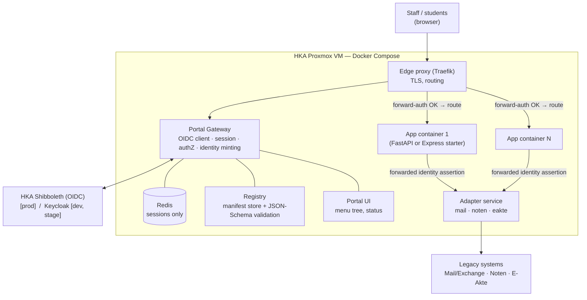
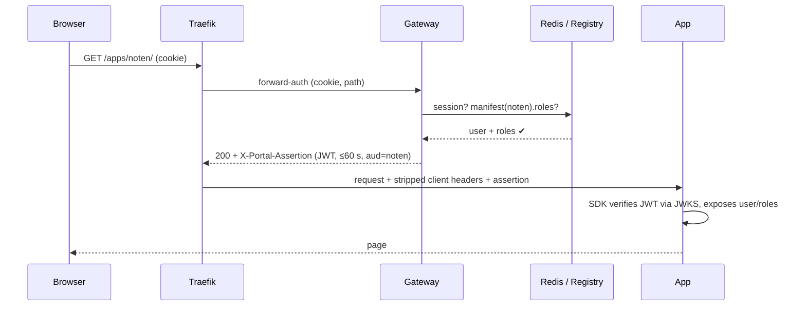
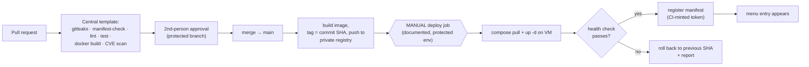

# Software Architecture Proposal — Micro-App Platform

**Status: a proposal, not a decision.** `01-architecture-decisions.md` remains the record of what is decided. This document fits those decisions, the open questions in `02`, and the contract findings in `03`/`06`/`07` into one coherent design the team can adopt, challenge, or hand to the AI tooling. Every choice carries its source (`E-0n` = decision from minutes, `AF-nn` = requirement/open item, `§x` = Angebot, `P-nn` = a proposal in this document). Where the design goes **beyond** the Angebot's wording, it says so (collected in §12).

## If you read only this

1. Five platform containers on one Proxmox VM with Docker Compose: **Traefik, Gateway (+registry +portal UI), Redis, Adapter service** — plus one container per app. No orchestrator, no extra database server.
2. **Traefik forward-auth** asks the gateway about every request; the gateway checks session and the manifest's roles (**deny-by-default**) and mints a **signed, ≤60 s identity assertion** that the app's SDK *verifies* instead of trusting a bare header (P-02).
3. Apps live **same-origin under `/apps/<slug>/`**; page chrome comes from the SDK, so the AI has no menu to build (P-03).
4. **Adapters enforce the calling app's declared scope and the acting user** on every call — closes the "any app can mail as any user" gap by construction (P-05).
5. **Central, non-overridable pipeline**; build may be automatic, the **deploy step is manual** (E-03, confirmed by the 15.10 recording) (P-07).
6. Walking skeleton for 19.11 = login → hello app via the manual deploy job → health check → registration → menu entry → one mock `noten` adapter call, from **one demonstrated prompt** (E-05).

---

## 1. Drivers

| Driver | Source | Consequence |
|---|---|---|
| Restartable, boring ops — HKA-IT must be able to restart it after months of silence | 08.10 *"wenn nach drei Monaten das System ausfällt…"*, E-01 | Docker Compose on one Proxmox VM; no orchestrator, no message bus, no DB server to run |
| Authors are laypeople plus AI, so apps are **untrusted by default** | Angebot §1, 08.10 | The platform *enforces* (gateway, pipeline); `AGENTS.md`/skills only *advise*: *"Regeln sind ein Rat, die Prüfungen sind Gesetz."* |
| Identity never reaches app code as a credential | Angebot §5.2, 08.10 | Gateway owns login/session; apps get a derived, short-lived identity |
| Four packages in parallel, integration not deferred | 08.10, `01` | Three frozen contracts plus a mock at every package boundary |
| Public institution | 08.10 | WCAG 2.1 AA, German-only UI, on-prem data |
| Single-digit apps, dozens of users, one instance each | Angebot §5.2, `02` §6 | No HA, no autoscaling; SQLite-class persistence is enough |

## 2. System context and containers



Platform services are **five containers** (edge, gateway+registry+portal-UI as one deployable, Redis, adapters) — deliberately not microservices. Gateway, registry and portal UI are one codebase in Package A; splitting later is a refactor, not a redesign.

## 3. Request path and trust model

**Forward-auth, not a custom reverse proxy (P-01).** Traefik routes `/apps/<slug>/*`; before forwarding it calls the gateway's `/auth/verify`. The gateway (1) reads the session cookie and looks it up in Redis, (2) looks up `<slug>` in the registry, (3) checks the user's roles against the manifest's `roles` — **deny-by-default**: no manifest or no matching role means 403 — and (4) answers 200 with a freshly minted identity assertion that Traefik copies onto the request. Sources: "gateway checks every request" Angebot §5.2; deny-by-default `02` §2 default.



**Proposed identity contract (new — contract #1 from `01`, needs team sign-off):**

- The gateway strips any client-supplied `X-Portal-*` / `X-User-*` headers at the edge.
- It sets **one signed assertion**: JWT, RS256, key held only by the gateway, minted per request, TTL ≤ 60 s, `aud` = app slug, claims `sub`, `name`, `roles[]`, `azp` — plus convenience plain headers derived from it.
- The starters' SDK **verifies** the assertion (JWKS cached) instead of trusting the header. Apps never see the IdP token or any password.
- **Why (P-02):** Angebot §5.2 says "Identität als Header" — still satisfied. But a bare header is only safe inside the shielded network (`02` ⚠ section, finding 10). A verified assertion stays safe even if AF-12 isolation is misconfigured and removes the forgery half of AF-14 at near-zero cost.
- **Wording tension to settle:** §5.2 says *"die App sieht keine Tokens"*. The assertion is not a user credential (not replayable beyond 60 s or beyond one app), but the sentence should read *"keine Zugangsdaten und keine Tokens des Identity-Providers"*.
- **AF-14 (externally running apps) is excluded from Phases 1–3** (`02` option b; finding 10's Abgrenzung line). The assertion design is what would make a later extension possible.

**Network segmentation (AF-12 made concrete):**

| Network | Members | Rule |
|---|---|---|
| `edge` | Traefik | Only published ports on the VM |
| `platform` (internal) | gateway, registry, Redis, adapters | **Apps cannot reach Redis or the registry** |
| `app-<slug>` (internal, one per app) | the app, Traefik | Apps cannot see each other (app-to-app not permitted for the pilot, `02` §2) |
| `adapters` (internal) | apps → adapter service | Only path from an app to a legacy system |

All app networks are `internal: true`, so **no internet egress** by default (`02` §6/§7 default). An allow-listed egress proxy is an explicit, logged exception and not part of the pilot. Traefik discovers apps from container labels through a **read-only docker-socket-proxy**, never the raw `docker.sock`.

## 4. Components and ownership

| Component | Responsibility | Tech (sourced) | Package |
|---|---|---|---|
| Edge | TLS, path routing, forward-auth hook | Traefik (`02` §6 default) | A |
| Gateway | OIDC code flow (Shibboleth prod / Keycloak dev+stage), Redis session (cookie only; 30 min idle / 8 h absolute — `02` §1), roles, assertion minting, JWKS endpoint | Python/FastAPI (same stack as a starter — the team uses its own golden master) | A |
| Registry | `PUT/DELETE /registry/apps/{slug}`, JSON-Schema validation, persistence | **SQLite** on a volume (nightly copy, `02` §6); the same schema file the pipeline's manifest-check uses | A |
| Portal UI | Server-rendered menu tree by category, filtered by roles; status page; "Meine Verbindungen" page (§6) | HTML + CSS per the design rules, no JS framework (Angebot §5.4, 08.10 "no library") | A + B |
| Adapter service | One adapter per legacy system, OpenAPI-defined (contract #3); backends `live` / `stage` / `mock` | FastAPI; generated clients for both SDKs | B |
| Design kit | Hochschul-CSS tokens, dialog/menu rules — **CSS plus rules, not a component library** (08.10) | static CSS | B |
| Portal SDK (×2) | `identity()`, `require_role()`, `layout()`, `adapters.client()`, `/healthz`, dev-mode shim; Python and Node from one spec with shared contract-test fixtures | thin libraries inside the starters | B + C |
| Starters | FastAPI and Express golden masters, five commands, manifest, DevContainer | Ruff/pytest, ESLint/Jest (§9.1 says Jest, the 22.10 deck shows `node:test` — align) | C |
| AI layer | `AGENTS.md`, seven skills, interface descriptions, check script behind "7 von 7" | Markdown | C |
| Pipeline | Central template, deploy, rollback, runbook | GitLab or GitHub — **undecided until 28.10** | D |

**Menu and layout without an iframe (P-03).** Apps live same-origin under `/apps/<slug>/`, so cookies, deep links and keyboard access just work. Page chrome (left menu, header) comes from the SDK's `layout()`, which fetches the nav fragment from the portal and caches it — the AI cannot "build its own menu" (skill `portal`) because there is no menu to build. Iframe mode stays a documented fallback for non-compliant apps (Streamlit question, `02` §9). The starters bake in the `/apps/<slug>` base path (`root_path` / router mount), the most common vibe-coding trap.

## 5. Manifest (contract #2) — sketch

```json
{
  "slug": "noten",
  "name": "Noten-Übersicht",
  "category": "Studium",
  "menu": { "label": "Meine Noten", "icon": "table" },
  "roles": ["student"],
  "adapters": ["noten:read"],
  "health": "/healthz",
  "version": "1.0.0"
}
```

`roles` and `adapters` are the least-privilege declaration: the gateway enforces the first, the adapter service the second. It answers the client's 22.10 ask that an access-denied case be traceable to a config line (AF-11 sharpening) — the line is in the manifest. Role *storage and administration* (LDAP vs. manifest vs. a management system, AF-11) stays open; for the pilot, roles come from an IdP claim and are declared per app in the manifest (`02` §2 defaults).

## 6. Legacy access and three different "secret" problems

The docs currently blur these; the architecture separates them.

1. **Calling legacy systems on behalf of a user (adapters, P-05).** The app forwards the assertion it received; the gateway mints it with `aud = [app, adapters]`. The adapter service verifies it and enforces **both** that the calling app (`azp`) declared that scope in its manifest and that it acts only as `sub`. An app can therefore act for a user only *during that user's own request* — no background impersonation, and the high-priority gap in `02` §2 ("can any app send mail as any user?") closes by construction. Cost: no scheduled/background jobs in the pilot, which the two read-mostly reference apps do not need.
2. **Non-SSO legacy credentials** (Exchange/E-Akte need a password — the client's split-secret problem, still open). Kept **entirely inside the adapter service**, never in apps. First probe: ask the Exchange admin whether service-account impersonation is possible (no user password at all). Fallback is the client's own sketch: the user enters the legacy password once on a portal page ("Meine Verbindungen"); the adapter stores it encrypted under a key combining a server half and a half held in the user's Redis session, so it lives only as long as the session. Until decided, adapters run in `mock` mode (the `02` default).
3. **Developer/app secrets** (API keys) — **not a vault product (P-06).** Injected at deploy time from the CI platform's protected variables into the container environment; apps read env. The 22.10 deck's "Portal-Tresor / Meine Secrets" UI is **outside the proposed scope** until it is priced (findings 11 and 22; the 15.10 recording shows the client wanted OIDC/JWT exhausted before any secret store).

AF-15 (per-system anonymised test/stage data, the "Infrastrukturanbieter" role) maps onto the adapter backends: `live` (prod), `stage` (anonymised dataset), `mock` (fixtures). Who provisions the `stage` data is the role the client asked for; the architecture only gives it a place to plug in.

## 7. Delivery pipeline and deployment (E-03 respected)



- **Build may be automatic on merge; loading the artifact into the container is the explicit manual step** (P-07) — the mechanism the client described on 15.10 (`07` finding A3). This is the inverse of the gate placement in the 22.10 deck and of Angebot §5.2/§6; both need correcting.
- **Central, non-overridable pipeline.** App repositories `include:` the pipeline from the golden-master/platform repository and cannot change stages or the deploy job; otherwise a layperson's (or an AI's) edit to CI config could deploy arbitrary things from a runner with Docker access. Protected branch and protected environment for deploy.
- Registration happens **after** the health check (Angebot §5.2) with a short-lived credential minted by the pipeline (`02` §4 default). Rollback = redeploy the previous SHA (one command, §5.2). Retire = stop the container and `DELETE` the manifest; the menu entry disappears.
- The three secret safeguards stay: commit hook in the DevContainer, platform push protection, pipeline gitleaks. The platform one may not exist on GitLab CE (finding 17) — one more input to the 28.10 Git decision.

## 8. Environments

§8.1 contracts **one** VM, but three environments are needed.

| Env | Where | IdP | Adapters | Purpose |
|---|---|---|---|---|
| dev | author's DevContainer | **SDK dev-mode shim**: test user with selectable roles, no Keycloak needed (matches `04` Teil 1a) | mock | write an app |
| stage / sandbox | second Compose project on the HKA VM, own hostname | Keycloak (E-04) | mock → anonymised `stage` | team integration, pilot, the client's early "play" window (AF-18) |
| prod | HKA VM | Shibboleth OIDC | live | operation |

Same Compose files with env overlays (P-08). Sharing the VM is the pragmatic reading — confirm with HKA-IT; a second VM would remove cross-environment risk. The dev-mode shim must be impossible to ship: the pipeline fails if `PORTAL_DEV` appears in a production image or compose file.

## 9. Operations and observability

Kept to what the Angebot promises: JSON logs to stdout (HKA-IT reads them with `docker logs`, §5.2); the gateway adds a request id; every adapter call writes an audit row (calling app, acting user, target system — `02` §12 default); `/healthz` per app, marked unavailable after three consecutive failures (`02` §12); a portal status page. Per-app Docker volume plus a runbook for backup and restore — no automatic backup, explicitly out of scope (§5.2). **No** Prometheus/Grafana or tracing: nobody would look at it.

## 10. Decisions with alternatives

| # | Decision | Rejected alternative | Why | Reversibility |
|---|---|---|---|---|
| P-01 | Forward-auth via Traefik plus a gateway verify endpoint | Gateway as full reverse proxy | Less custom code; label routing is already `02`'s default | High |
| P-02 | Signed per-request assertion that the SDK verifies | Trust plain headers inside the network | Safe even if segmentation fails; unblocks AF-14 later | Medium (contract #1) |
| P-03 | Same-origin path prefix plus SDK layout | Iframe shell; subdomain per app | Accessibility, cookies, deep links; no wildcard DNS/cert | Medium |
| P-04 | SQLite registry, Redis for sessions only | Postgres | One fewer service to operate for ≤ 10 apps | High |
| P-05 | Adapter enforces `azp` scope and `sub` per call | Pass-through adapter | Closes the "any app mails as any user" gap | Medium |
| P-06 | Secrets via CI variables → env; no vault | Portal-Tresor | Unpriced; client sceptical; revisit with AF-13 | High |
| P-07 | Central pipeline template, manual deploy job | Per-repo CI config, auto-deploy | Prevents CI-config abuse; E-03 | High |
| P-08 | One VM, three Compose projects | Separate VMs | Only one VM is contracted | High |

## 11. Build order and the Durchstich slice (19.11)

Freeze the contracts in **week 1**: assertion/JWKS shape, manifest JSON Schema, adapter OpenAPI (`noten` and `mail`). Each package then builds against a mock of the other side:

- **A** gateway + registry against Keycloak.
- **B** adapter mock + SDK against a recorded assertion fixture.
- **C** starter against the SDK dev shim.
- **D** central pipeline + VM + manual deploy against a hello-world image.

The walking skeleton is exactly the client's definition (`01`) plus **E-05**: *login (Keycloak) → hello app deployed by the manual job → health check → registration → menu entry → one `noten` adapter call on the mock backend → rendered*, produced from **one demonstrated prompt**. "Hello World reicht"; a rudimentary adapter is fine. The Shibboleth-OIDC swap and live adapters follow after the client's 05.11 and 26.11 deliveries; nothing in A–D blocks on them.

## 12. Beyond the Angebot, and not decided here

**New relative to the Angebot's wording** (each is also in §10): the signed assertion (P-02), SDK-rendered layout (P-03), SQLite registry (P-04), per-call scope enforcement in adapters (P-05), central pipeline template (P-07), a stage environment on the same VM (P-08).

**Needs the team or client:**

1. Git platform (28.10) — drives pipeline syntax, the push-protection tier, and the GitLab references hard-coded in the deck.
2. Pilot window (KW 50 vs. KW 2–3) — unaffected by this design.
3. Assertion wording vs. §5.2 ("keine Tokens"); who presses the manual deploy button (the merger? HKA-IT?), since §6 still says *"Ein Merge rollt die App aus"*.
4. Legacy-credential scheme (impersonation vs. split-secret) — needs Exchange admin input.
5. Role administration (AF-11) and the Tresor (AF-13) — priced scope or explicit exclusion.
6. A second VM for stage, and test-data provisioning (AF-15).

---

## Update 25.10.2026 — revisions from `09-component-design.md`

Working through the components in `09-component-design.md` exposed problems in this document's own choices. The body above is left as written; where it conflicts with `09`, **`09` wins**. Superseded statements:

| # | Revision | Supersedes in this document |
|---|---|---|
| R1 | Traefik routes come from **registry-generated file-provider config**; no Docker labels, no docker-socket-proxy | §3 last bullet; §4 Edge row |
| R2 | Edge strips `Cookie` towards apps and `Set-Cookie` from apps; apps have no cookies | §3 (not stated before) |
| R3 | Same-origin path routing is one trust domain; hardening set and a wildcard-DNS request; origin-per-app as a later switch | §4 "Menu and layout" paragraph; P-03 |
| R4 | No plain identity headers; assertion only | §3 "convenience plain headers" |
| R5 | Gateway puts granted adapter scopes into an `scp` claim; adapters need only the JWKS; manifest `claims` allow-list | §6 item 1 (adapter enforcement mechanism) |
| R6 | Single internal `apps` network plus a mandatory deploy-time conformance probe | §3 network table (`app-<slug>` rows); P-08 context |
| R7 | Redis is ephemeral | §4 Registry row ("nightly copy" applies to SQLite only) |
| R8 | Build (`ci`, rootless) and deploy (`deployer`) run as different users; the single VM is unsized in §8.1 | §7 (not stated before) |
| R9 | SDK vendored with a hash check | §4 SDK row |
| R10 | Identical `Makefile` in both starters | §4 Starters row |
