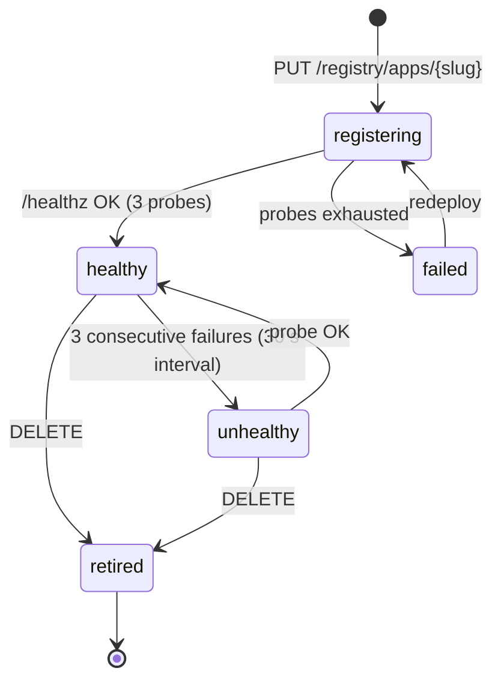
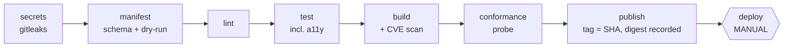

# Component Design — Deep Dive into the Proposed Architecture

**Status: a proposal, not a decision.** `08-software-architecture-proposal.md` fixes the shape of the platform. This document takes each component apart: responsibilities, interfaces, data, behaviour, failure modes, tests. Working through the details exposed **defects in 08's own choices**, so this document *revises* 08 (table below); 08 carries a dated pointer rather than a silent rewrite. Sources are cited as in `01` (`E-0n`, `AF-nn`, `§x` = Angebot) plus `P-nn` (08), `R-nn` (this document), and finding numbers from `03`/`06`/`07`.

**Verify-at-implementation markers.** Design points that depend on exact behaviour of a third-party tool are marked ⚑ and must be confirmed against the pinned version before they are relied on.

## If you read only this

1. **Routing config is generated from the validated manifest, never from author-written Docker labels** (R1). No `docker.sock` is exposed to any platform component.
2. **Apps neither receive nor set cookies** (R2). The only identity an app ever sees is a 60-second signed assertion that its SDK verifies.
3. **Path-prefix apps share one browser origin, so an XSS in one app is an XSS in all** (R3). Phases 1–3 live with a hardening set (strict CSP, CSRF check, no cookies); **ask HKA-IT now for a wildcard DNS name and certificate** so origin-per-app is a configuration switch later.
4. **Build and deploy run as different Unix users** (R8): the builder runs authors' code with no platform access; the deployer runs only central scripts.
5. **A deploy-time conformance probe is the real gate**: an app that does not reject requests without a valid assertion is never registered (R6, R9).
6. The VM is **unsized** in §8.1 and must carry platform, stage and CI builds — ask for 4–6 vCPU and 12–16 GB (§13).

---

## Revisions to 08

| # | Problem found in 08 | Revision | Severity |
|---|---|---|---|
| R1 | Traefik discovers apps through Docker **labels**, which live in the app's compose file — author-controlled input. An author could omit the auth middleware or claim another app's path. | The registry **renders Traefik file-provider config** from the validated manifest only (slug regex, reserved names). No labels, **no docker.sock, no socket-proxy**. Compose is generated centrally; authors never write it. | High |
| R2 | The portal session cookie is sent to every app (same origin, `Path=/`). A malicious or compromised app can lift it from logs or its volume and replay it against the whole portal, or overwrite it with `Set-Cookie`. | The edge strips `Cookie` towards apps and `Set-Cookie` from apps. **Apps have no cookies.** | High |
| R3 | P-03 treats same-origin as a pure convenience. It is also **one trust domain**: script in `/apps/a/` can `fetch` or `window.open` `/apps/b/` as the visitor. | Keep path-prefix for Phases 1–3 with the hardening set in §1.5; request wildcard DNS and certificate; make origin-per-app a config switch. State the residual risk. | High |
| R4 | 08 also sends plain identity headers "for convenience". Authors and the AI will read and trust them. | **No plain identity headers.** Assertion only; the SDK is the sole reader. | Medium |
| R5 | Adapters look the caller's scopes up in the registry. | The gateway embeds granted adapter scopes as an `scp` claim; adapters need only the JWKS. Manifest `claims` allow-list gives data minimisation. | Medium |
| R6 | One internal network per app requires `docker network connect` for Traefik after every platform recreate — a handover trap. | **Single internal `apps` network.** Isolation rests on `aud` verification, enforced by a mandatory deploy-time **conformance probe**. Per-app networks remain a Phase-4 option. | Medium |
| R7 | Redis "backed up nightly" (`02` §6 default). | Redis is **ephemeral** (no AOF/RDB). Losing it means a silent re-login through the IdP session. | Low |
| R8 | CI runs authors' code (tests, `RUN` steps). On a runner holding the platform's Docker socket that is host takeover — and §8.1 contracts one VM. | Split users: rootless **`ci`** builder vs. **`deployer`** that runs only central script. | High |
| R9 | A removed or altered SDK check is the main way an app fails open. | SDK is vendored with a **hash check against released versions**; the conformance probe catches the rest. | Medium |
| R10 | "Immer gleiche Befehle" holds only by task name (`poe` vs. `npm run`; deck finding C4). | Identical **`Makefile`** in both starters. | Low |

---

## 0. Foundations

### 0.1 Trust zones

| Zone | Contains | Trusted to | Never trusted to |
|---|---|---|---|
| Browser | user, any JS served by apps | — | anything; it holds only the HttpOnly session cookie |
| Edge | Traefik | route, terminate TLS, strip/force headers | decide authorization |
| Platform core | gateway (+registry, portal UI), Redis, adapters | authenticate, authorize, mint, audit | — |
| App zone | app containers on `apps` | serve their own pages, verify assertions | see cookies, reach Redis/registry, reach the internet |
| Build zone | `ci` user, rootless builder | run authors' code | touch platform sockets or secrets |
| Deploy zone | `deployer` user, `deploy.sh` | run central script only | execute author-controlled files |

### 0.2 Threat table

| Threat | Control | Residual |
|---|---|---|
| Stolen session cookie via a malicious/compromised app | Apps get no cookies (R2); cookie is `HttpOnly`, `__Host-` prefixed | none via apps |
| XSS in app A reads app B as the visitor | Strict CSP, no cookie forwarding, CSRF/Fetch-Metadata gate (§1.5) | **Open** until origin-per-app; same-origin `window.open` is not blockable |
| Assertion replay | ≤ 60 s lifetime, `aud` = one app, `jti` logged | replay inside 60 s by the same app only |
| Slug hijack / overwrite of another app | Slug bound to repo path at first registration (§3.4) | first-registrant-wins race (mitigated: manual deploy) |
| SSRF from an app to platform services | `apps` network has no route to Redis/registry; conformance probe verifies | gateway JWKS listener is reachable by design (public key only) |
| Author edits CI config to deploy arbitrary things | Non-overridable pipeline (§9.2); deploy job is central | depends on the chosen Git platform's tier |
| CI job escapes to the host | Rootless builder, no platform socket (R8) | kernel-level escape; mitigated by keeping the VM patched |
| Dev-mode shim reaches production | SDK refuses under `PORTAL_ENV=production`; pipeline greps images | none expected |
| Poisoned or stripped SDK | Vendored hash check + conformance probe (R9) | author controls the app's non-SDK code |
| Noisy neighbour exhausts the VM | Per-container CPU, memory, pids limits from the central template | VM-level disk filling by logs (log rotation) |

### 0.3 Assertion v1 (contract #1)

```json
{
  "iss": "https://portal.hka.example/",
  "sub": "idp-subject-id",
  "name": "Erika Muster",
  "roles": ["student"],
  "aud": ["noten", "portal", "adapters"],
  "azp": "noten",
  "scp": ["noten:read"],
  "iat": 1792924800,
  "exp": 1792924860,
  "jti": "b3f1c0de-7a52-4d0f-9d41-2f6f0b9a1c11",
  "v": 1
}
```

- **Algorithm pinned to RS256**; the verifier rejects `none` and any HMAC algorithm. Header carries `kid`. (RS256 is the `02` §3 default.)
- `aud` always contains the app slug and `portal`; `adapters` only when the manifest declares adapter scopes. `scp` carries exactly the declared scopes (R5).
- Claims beyond `sub`, `roles`, `name` appear only if the manifest's `claims` list asks for them (e.g. `email`). This supports the per-app processing-register entry in `02` §11.
- The JWKS lists the **current and previous key**; rotation is manual (`02` §3 default). SDKs cache the JWKS 5 minutes and refetch on an unknown `kid`, at most once per 30 s.
- Verifier leeway 5 s on `iat`/`exp`. All containers share the VM clock; NTP on the VM is a runbook item.

### 0.4 Secrets inventory

All secrets are **file-based Docker secrets** under `/etc/portal/secrets` (root-owned, mode 0400), never environment variables (those leak through `docker inspect`).

| Secret | Used by | Notes |
|---|---|---|
| OIDC client credential | gateway | per environment (Keycloak for dev/stage, Shibboleth for prod) |
| Redis password | gateway | Redis is on `platform` only |
| JWT signing key | gateway | generated on first start, 0400; backed up with the runbook |
| Registrar token | `deployer` → registry | readable only by the `deployer` user |
| Adapter backend credentials | adapters | service accounts; user passwords never stored (§5.4) |
| TLS certificate + key | Traefik | delivered as an **external volume**, as the client asked on 08.10 |
| App secrets | app container | `/etc/portal/apps/<slug>.env`, 0600, written by `deploy.sh` from protected CI variables (P-06) |

---

## 1. Edge — Traefik

### 1.1 Responsibilities

TLS termination, path routing to apps and portal, calling the gateway for authorization, forcing security headers. **No** authorization logic.

### 1.2 Static configuration (essentials)

```yaml
entryPoints:
  websecure: { address: ":443" }
  web:
    address: ":80"
    http: { redirections: { entryPoint: { to: websecure, scheme: https } } }
providers:
  file:
    directory: /etc/traefik/dynamic   # platform.yml (static) + apps/*.yml (generated)
    watch: true
ping: {}                              # health endpoint for Compose
accessLog:
  format: json
  fields:
    headers: { defaultMode: drop }    # never log Cookie or the assertion
```

### 1.3 Middlewares (platform.yml)

```yaml
http:
  middlewares:
    portal-auth:
      forwardAuth:
        address: "http://gateway:8000/auth/verify"
        trustForwardHeader: false
        authResponseHeaders: [X-Portal-Assertion, X-Request-Id]
    app-no-cookies:
      headers:
        customRequestHeaders:  { Cookie: "" }       # empty value removes the header ⚑
        customResponseHeaders: { Set-Cookie: "" }   # apps cannot set cookies ⚑
    app-security-headers:
      headers:
        stsSeconds: 31536000
        contentTypeNosniff: true
        referrerPolicy: "same-origin"
        customResponseHeaders:
          Content-Security-Policy: "default-src 'self'; script-src 'self'; style-src 'self'; img-src 'self' data:; object-src 'none'; base-uri 'none'; frame-ancestors 'none'; form-action 'self'"
    app-limits:
      chain: { middlewares: [app-rate, app-body] }
    app-rate:  { rateLimit: { average: 50, burst: 100 } }
    app-body:  { buffering: { maxRequestBodyBytes: 10485760 } }
    app-chain:
      chain:
        middlewares: [app-security-headers, portal-auth, app-limits, app-no-cookies]
```

**Order matters.** `portal-auth` runs *before* `app-no-cookies`, so the gateway sees the original cookie while the app never does. Behaviour to confirm in the pinned Traefik version ⚑: (a) a non-2xx forwardAuth response, including its `Location`, is returned to the client unchanged; (b) an empty-valued entry in `customRequestHeaders`/`customResponseHeaders` deletes the header; (c) `authResponseHeaders` replaces any same-named client-supplied header. If (c) fails, add an explicit header-stripping middleware ahead of `portal-auth`.

### 1.4 Generated per-app config (R1)

Written by the registry, one file per app, atomically (temp file + rename):

```yaml
# /etc/traefik/dynamic/apps/noten.yml — GENERATED, do not edit
http:
  routers:
    app-noten:
      rule: "PathPrefix(`/apps/noten`)"
      entryPoints: [websecure]
      middlewares: [app-chain]
      service: app-noten
      tls: {}
  services:
    app-noten:
      loadBalancer:
        servers: [{ url: "http://noten:8080" }]
```

Because the file is rendered from a manifest that already passed the schema (slug pattern, reserved names), nothing an author writes can alter the rule, the middleware chain, or the upstream. A lowest-priority catch-all router sends unknown `/apps/*` paths to the gateway for a friendly 404 in einfacher Sprache.

### 1.5 Hardening set for the shared origin (R3)

| # | Control | Where | Strength |
|---|---|---|---|
| H1 | No cookies to or from apps | edge (§1.3) | must |
| H2 | Strict CSP forced on every app response (no inline script, no CDN, no framing) | edge | must |
| H3 | `Referrer-Policy: same-origin` forced | edge | must |
| H4 | CSRF: on unsafe methods the gateway requires `Origin` host = `X-Forwarded-Host` (or `Sec-Fetch-Site: same-origin`/`none`) | gateway `/auth/verify` | must |
| H5 | Fetch-Metadata gate: for non-navigation requests (`Sec-Fetch-Mode` ≠ `navigate`) require the `Referer` path to start with `/apps/<slug>/` or the portal | gateway | should; enable after the Durchstich, test with Playwright |
| H6 | Conformance probe at deploy (§9.3) | pipeline | must |

**Residual risk, stated plainly.** H1–H5 raise the cost of cross-app abuse, but a hostile page can still open a same-origin popup to another app and read its DOM; strict CSP makes an *accidental* XSS hard to exploit, and four-eyes review is the control for *malicious* authors. The structural fix is **one origin per app** (`noten.apps.<domain>`), which needs wildcard DNS and certificate from HKA and a per-app session handshake. Keep that door open now: the SDK reads `PORTAL_BASE_PATH` (empty under host routing) and never builds absolute paths itself.

### 1.6 Edge failure modes and tests

Traefik down → portal unreachable; Compose restarts it (healthcheck on `ping`). Test: Playwright requests with a forged `Cookie`/`X-Portal-Assertion` header confirm the app sees neither a cookie nor a client-supplied assertion.

---

## 2. Gateway

### 2.1 Interfaces

| Endpoint | Listener | Purpose |
|---|---|---|
| `GET /login?next=` | main (:8000) | start OIDC code flow with PKCE (S256), `state`, `nonce` |
| `GET /oidc/callback` | main | validate state, exchange code, validate ID token, create session |
| `POST /logout` | main | CSRF-protected; deletes the portal session (SLO not required, `02` §1 default) |
| `GET /auth/verify` | main | forward-auth decision (§2.3) |
| `GET /_portal/nav` | main | role-filtered nav fragment for the SDK; requires an assertion with `aud ∋ portal` |
| `GET /.well-known/jwks.json` | **separate listener (:8001)** | public keys; the only gateway port reachable from `apps` |

`apps` can reach :8001 only; :8000 is bound to the `platform` network. (If a single process makes this awkward, run :8001 as a tiny second container.)

### 2.2 Session model

- Cookie `__Host-portal_sid`: `Secure`, `HttpOnly`, `SameSite=Lax`, `Path=/`, no `Domain`. The value is 256 random bits; it carries no data.
- Redis keys (all with TTL; Redis is ephemeral, R7):

| Key | Content | TTL |
|---|---|---|
| `sess:{sid}` | hash: `sub`, `name`, `roles`, `id_token_hint`, `created`, `last_seen`, optional `legacy_half` | 30 min idle, refreshed at most once per minute |
| `oidc:{state}` | PKCE verifier, nonce, `next` | 10 min |
| `rl:login:{ip}` | login attempt counter | 5 min |

- Absolute lifetime 8 h is checked from `created` (`02` §1 defaults). **The session id is rotated at login** (fixation defence).

### 2.3 `/auth/verify` decision table

| Condition (evaluated in order) | Response |
|---|---|
| No valid session; request is an HTML `GET` | 302 → `/login?next=<original URI>` |
| No valid session; anything else | 401 |
| Slug not in the registry | 404 |
| App status ≠ `healthy` | 503 with "App vorübergehend nicht verfügbar" |
| User's roles ∩ manifest `roles` = ∅ | 403 |
| Unsafe method and foreign/absent-where-required `Origin` (H4) | 403 |
| Non-navigation request failing H5 (when enabled) | 403 |
| Otherwise | 200 + `X-Portal-Assertion` + `X-Request-Id` |

The minted assertion is cached in memory per `(sid, slug)` until `exp − 15 s`, so asset-heavy pages do not sign dozens of JWTs. Deny-by-default is structural: **no manifest and no matching role means no 200**.

### 2.4 Roles (what AF-11 really leaves open)

IdP claims map to platform roles through a small checked-in file; explicit grants cover exceptions:

```yaml
# roles.yml — claim value -> platform role
eduPersonAffiliation:
  student: student
  employee: employee
  faculty: professor
# grants.yml — per-user additions, maintained by the team/IT
grants:
  - { sub: "idp-subject-id", roles: [pilot-tester] }
```

Consequence worth saying out loud: **a manifest can only reference roles this mapper can produce.** Fine-grained per-app roles (the XIS-style `namespace:role:permission` the client described on 15.10) stay open under AF-11 until the client decides where role data lives (LDAP groups, manifest, or a management system). Attribute release by the new Shibboleth is itself unresolved (`02` §1); the default is name, email and one affiliation/group attribute.

### 2.5 Failure modes

| Failure | Behaviour |
|---|---|
| Redis down | `/auth/verify` fails **closed** (503); portal shows a maintenance page |
| IdP down | existing sessions keep working (the verify path never calls the IdP); new logins fail |
| Signing key lost | regenerate; SDKs refetch the JWKS on the unknown `kid`; users are not logged out |
| Registry DB unreadable | in-memory registry cache keeps serving; status page flags it |

### 2.6 Tests

Unit: decision table (one case per row). Contract: assertion fixtures shared with both SDKs. Integration: Keycloak realm export checked into the repo with **three test users covering three roles**, which also pre-fills the "≥ 3 roles" request in §8.1. E2E: §11.

---

## 3. Registry

### 3.1 Data model (SQLite, WAL mode; copy with `sqlite3 .backup`)

| Table | Columns (essentials) |
|---|---|
| `apps` | `slug` PK, `manifest_json`, `version`, `status`, `owner_repo`, `registered_at`, `updated_at` |
| `deployments` | `id`, `slug`, `image_digest`, `deployed_at`, `deployed_by`, `result`, `previous_digest` |
| `audit` | append-only `ts`, `actor`, `action`, `slug`, `detail` |

The database is the **source of truth**; Traefik files are derived. On start the registry re-renders every file (self-healing after a lost volume or a half-written file).

### 3.2 Manifest schema (contract #2)

```json
{
  "$schema": "https://json-schema.org/draft/2020-12/schema",
  "type": "object",
  "additionalProperties": false,
  "required": ["slug", "name", "category", "menu", "roles", "version"],
  "properties": {
    "slug": { "type": "string", "pattern": "^[a-z][a-z0-9-]{2,30}$", "not": { "enum": ["_portal", "admin", "api", "auth", "static", "apps", "portal", "adapters"] } },
    "name": { "type": "string", "maxLength": 60 },
    "category": { "enum": ["Studium", "Verwaltung", "Kommunikation", "Sonstiges"] },
    "menu": {
      "type": "object", "additionalProperties": false, "required": ["label"],
      "properties": { "label": { "type": "string", "maxLength": 40 }, "icon": { "enum": ["table", "mail", "calendar", "file", "user", "chart"] } }
    },
    "roles": { "type": "array", "minItems": 1, "items": { "type": "string", "pattern": "^[a-z][a-z0-9-]{1,30}$" } },
    "adapters": { "type": "array", "items": { "type": "string", "pattern": "^(mail|noten|eakte):(read|write|send)$" } },
    "claims": { "type": "array", "items": { "enum": ["email"] } },
    "version": { "type": "string", "pattern": "^\\d+\\.\\d+\\.\\d+$" }
  }
}
```

Design notes: `additionalProperties:false` everywhere (a typo fails the build instead of silently doing nothing); `roles` has `minItems: 1` (deny-by-default has no "everyone" escape hatch — if all staff may see an app, that is the `employee` role); icons are an allow-list, not URLs (CSP forbids remote images); the health path is a platform constant (`/healthz`) and the port is fixed at 8080, so there are **fewer fields to get wrong**. The pipeline's manifest-check, the registry, and the SDK all load this one file. Adapter-scope strings are additionally cross-checked against the adapters' OpenAPI.

### 3.3 State machine



Only `healthy` apps appear in the menu and pass `/auth/verify`. The **registry** performs the probe — the Angebot's "Erst wenn der Health Check besteht, trägt sie die App im Portal ein" (§5.2) — rather than trusting the deploy script's say-so.

### 3.4 Registration authorization and slug ownership

`PUT`/`DELETE` require the registrar token, readable only by the `deployer` user (R8), so authors cannot call it. `deploy.sh` passes the repository path from the CI context; the registry stores it as `owner_repo` at first registration and **rejects a later registration of the same slug from a different repository**. Upgrade path, once the Git platform is fixed: replace the token with the platform's OIDC job tokens and bind `owner_repo` to the verified claim.

### 3.5 Interfaces

`PUT/DELETE /registry/apps/{slug}`, `GET /registry/apps` (gateway-internal), `POST /registry/validate` (dry run for the pipeline's manifest stage). All on the `platform` network only.

---

## 4. Portal UI and design kit

### 4.1 Portal UI

Server-rendered Jinja2 pages inside the gateway process, no JavaScript framework (Angebot §5.4; client rejected a component library on 08.10).

| Page | Content |
|---|---|
| `/` | menu tree by category, filtered by the user's roles and `healthy` status; alphabetical (`02` §4 default) |
| `/_portal/status` | health table for HKA-IT (role-gated) |
| `/_portal/connections` | "Meine Verbindungen": where a user enters a legacy password once, if the split-secret scheme is chosen (§5.4) |
| 403 / 404 / 503 | short messages in einfacher Sprache, with the next step |

Accessibility is built in, not bolted on: `lang="de"`, landmarks, skip link, visible focus, full keyboard operation.

### 4.2 Design kit — CSS plus rules, not a component library

- **Tokens** as CSS custom properties; **documented HTML patterns** for the left menu, the native `<dialog>` with exactly two buttons, labelled form fields with error text, tables with captions. The same patterns are the content of the `design` and `ui-regeln` skills.
- **Self-hosted fonts**, no CDN — the lesson from deck finding C2 (live Google Fonts calls, GDPR exposure).
- **Contrast is generated, not asserted:** CI computes the WCAG ratio for every text/background token pair and fails below 4.5:1. This is what would have caught deck finding C1 (`#9a9fa8` at ≈2.6:1).
- **Accessibility gate:** axe-core driven by Playwright over the portal pages and the reference apps — the automated acceptance proof `02` §8 recommended.
- Served by the portal at `/_portal/static/kit-<semver>.css`; the SDK layout references it, so a restyle reaches all apps without redeploying them. Guard: visual-regression screenshots of the two reference apps on every kit release.
- The institutional design manual is still unconfirmed (`02` §9, blocks package B): start with a neutral palette behind the same tokens.

### 4.3 Layout contract

An app never builds a menu. The SDK `layout()` fetches `/_portal/nav` (authenticated by the app's own assertion, `aud ∋ portal`), caches it per user/role set for 60 s, and wraps the app's content. Skill `portal` therefore states a *capability*, not a prohibition the AI might ignore.

---

## 5. Adapter service

### 5.1 Structure and interfaces

One FastAPI service, one router per system: `/v1/noten`, `/v1/mail`, `/v1/eakte`. Each adapter's **OpenAPI file is the contract** (#3) that the AI-facing `schnittstellen` skill points at, and from which both SDKs' clients are generated. Errors are RFC 9457 `application/problem+json`.

### 5.2 Authentication and authorization (R5)

1. Verify the bearer assertion (same JWKS), require `adapters ∈ aud`.
2. Route requires scope S (e.g. `noten:read`); require `S ∈ scp`.
3. Per-system role policy (e.g. `noten` only for `student`), from a small checked-in file.
4. The adapter acts **only as `sub`**; there is no way to name another user.

Effect: an app can use a legacy system only for a user *currently making a request to that app*. There is no background impersonation, which closes the high-priority gap in `02` §2 by construction. Cost: no scheduled jobs in the pilot.

### 5.3 Backends

```python
class NotenBackend(Protocol):
    def grades(self, sub: str) -> list[Grade]: ...
# implementations: MockNoten (fixtures keyed by test user), StageNoten (anonymised data), LiveNoten
```

`ADAPTER_NOTEN_BACKEND = mock | stage | live` per environment. The **same contract-test suite runs against `mock` and `stage`**, so a mock that drifts from the real shape fails CI. `stage` is where the client's AF-15 "Infrastrukturanbieter" role plugs in: whoever provisions anonymised datasets only has to satisfy this interface.

### 5.4 Legacy authentication strategies (behind the backend interface)

| Strategy | When | Status |
|---|---|---|
| `service_account` | system offers an API credential for the platform | preferred; used for the stage backends |
| `impersonation` | e.g. Exchange application impersonation — no user password at all | **first thing to ask the Exchange admin** |
| `user_password` | client's split-secret sketch: user enters the password once on "Meine Verbindungen"; stored encrypted under a key combining a server half and a half in the user's Redis session | design only; decision open |

Until one is confirmed, `mail` and `eakte` run as `mock` (the `02` §5 default: stub until an API path is confirmed).

### 5.5 Mail specifics

Per-user send rate limit and size cap; `Idempotency-Key` header so a retry cannot double-send; sender is the shared no-reply account (`02` §5 default); the reference app sends only to a test address (Angebot §6).

### 5.6 Reliability and audit

Upstream timeout 5 s, a minimal circuit breaker per backend, explicit 504/503 problem responses. **Audit** is an append-only JSONL file on its own volume, one line per call — `ts, request_id, azp, sub, system, op, status, ms` — with **no payloads or mail content** (`02` §12 default plus data minimisation). Retention is an open data-protection decision (`02` §11 suggests 30 days for logs).

---

## 6. Portal SDK (Python and Node)

### 6.1 Surface (identical in both languages)

| Function | Behaviour |
|---|---|
| `init(app, manifest_path)` | mounts the app under `PORTAL_BASE_PATH`, installs the verification middleware, adds `/healthz`, loads the manifest |
| `user()` | returns `{sub, name, roles}` from the verified assertion |
| `requires(role)` | second line of defence inside an app |
| `layout(title, body)` | wraps content with kit CSS and the portal nav (§4.3) |
| `adapters.<system>` | generated client; attaches the assertion; maps errors |
| `base_path()` | for building links |

### 6.2 Fail-closed default

Every route requires a verified assertion **unless explicitly marked public**; the only public route is `/healthz`. A route an author forgets to protect is therefore protected.

### 6.3 Verification checklist

Reject: wrong or missing `kid`; algorithm other than RS256; `iss` mismatch; `aud` lacking the app's slug; expired or future-dated beyond leeway; missing `v`. The shared fixture set (valid, expired, wrong `aud`, `alg:none`, tampered signature, unknown `kid`, wrong `iss`) runs in **both SDKs' CI** — parity is tested, not hoped for.

### 6.4 Dev-mode shim

`PORTAL_DEV=1` enables a local page to choose a test user and roles (stored in a signed dev cookie), so authors need neither Keycloak nor a real account (matches `04` Teil 1a). Guards: the SDK refuses to start in dev mode if `PORTAL_ENV=production`; the pipeline fails if the string `PORTAL_DEV` appears in the production compose output or image environment.

### 6.5 Distribution (R9)

Vendored inside the starter (`platform_sdk/`) with a `SDK_VERSION` file. The pipeline compares the directory hash with the released hash for that version and fails on a mismatch. This keeps the SDK independent of whichever package registry the 28.10 Git decision brings; `make sdk-update` pulls a newer release. Hash check plus the conformance probe cover both "SDK edited" and "SDK never called".

---

## 7. Starters and the runtime template

### 7.1 Layout (both starters)

```
AGENTS.md  manifest.json  README.md  Makefile  Dockerfile
.agents/skills/{design,barrierefreiheit,ui-regeln,schnittstellen,portal,pipeline-fehler,secrets}/SKILL.md
.devcontainer/{devcontainer.json,Dockerfile}
.pre-commit-config.yaml            # gitleaks + ruff/eslint
platform_sdk/  src/  tests/
```

Authors never write a compose file; the pipeline-side template (§7.3) builds it.

### 7.2 One command set (R10)

```make
# identical in both starters; delegates to poe (Python) or npm (Node)
dev:    ; $(RUNNER) dev
start:  ; $(RUNNER) start
test:   ; $(RUNNER) test
lint:   ; $(RUNNER) lint
docker: ; docker build -t app:local .   # same Dockerfile the pipeline builds
```

`RUNNER` is `poe` or `npm run` set at the top of the file. A user types `make dev` in either starter — the client's original complaint (`npm run web` vs. `npm run dev`) is gone literally, not just by naming.

### 7.3 Central compose template (applied by `deploy.sh`)

```yaml
services:
  app:
    image: "registry.local/{{ slug }}@{{ digest }}"
    user: "10001:10001"
    read_only: true
    tmpfs: ["/tmp"]
    cap_drop: ["ALL"]
    security_opt: ["no-new-privileges:true"]
    pids_limit: 128
    mem_limit: 512m          # 02 §6 default
    cpus: 0.5
    env_file: ["/etc/portal/apps/{{ slug }}.env"]
    environment:
      PORTAL_ENV: production
      PORTAL_BASE_PATH: "/apps/{{ slug }}"
    volumes: ["data-{{ slug }}:/data"]
    networks:
      apps: { aliases: ["{{ slug }}"] }
      adapters: {}
    healthcheck:
      test: ["CMD", "/app/healthcheck"]   # provided by the starter; no curl dependency
      interval: 10s
      timeout: 3s
      retries: 3
    logging: { driver: json-file, options: { max-size: "10m", max-file: "5" } }
networks:
  apps: { external: true }
  adapters: { external: true }
volumes:
  data-{{ slug }}: {}
```

The template is where "rules are advice, gates are law" becomes literal: an AI-built app cannot request extra privileges, volumes, ports, or networks, because it does not author this file. Default persistence in the starters is a small SQLite helper on `/data` (no database server per app).

### 7.4 Dockerfile conventions

Multi-stage; non-root user; single port 8080; no secrets or `.env` copied in; `HEALTHCHECK` provided; the process must run with a read-only root filesystem (writes only to `/tmp` and `/data`). The conformance probe (§9.3) fails images that violate this.

### 7.5 Base path

One code path everywhere: `PORTAL_BASE_PATH` is empty in dev, `/apps/<slug>` in production, and (later) empty again under host routing. This is the most common trap in path-prefixed apps; the starters bake it in and `portal` skill rule R-PORTAL-3 forbids absolute links.

---

## 8. AI layer

### 8.1 `AGENTS.md` (always loaded, ≤ ~100 lines)

Sections: what this repository is; the five `make` commands; **hard rules** (no own login, no secrets in code or config, no own menu, no direct HTTP to other systems, no external CDNs, German UI in einfacher Sprache, `/healthz` stays); skill index with one-line triggers; the duty to log decisions in `README.md` (Angebot §5.1); "when unsure, ask the user instead of guessing".

### 8.2 Rules are testable, or they are labelled as manual

| Skill | Example rule | Check | Runs in |
|---|---|---|---|
| `design` | colours and spacing only from kit tokens | stylelint allow-list (no hex literals outside tokens) | `make lint` |
| `barrierefreiheit` | contrast ≥ 4.5:1, keyboard operable, labelled fields (WCAG 2.1 AA) | axe-core via Playwright against the dev server; token contrast matrix | `make test` |
| `ui-regeln` | menu left, dialog has exactly two buttons | menu: structural (comes from `layout()`); dialog: template lint plus manual review | `make test` + Prüfprotokoll |
| `schnittstellen` | other systems only through the generated adapter client | banned imports (`requests`, `httpx`, `axios`, `node-fetch`) via ruff/ESLint restricted-imports; runtime egress denied | `make lint` + conformance |
| `portal` | no own login, no own menu, relative links | banned auth libraries; "every route returns 401 without an assertion" test | `make test` + conformance |
| `secrets` | no key in code, config or logs | gitleaks (commit hook + pipeline) | hook + CI |
| `pipeline-fehler` | on a red pipeline explain cause and next step | semi-automatic rubric on an **injected** failing log (below) | Prüfskript |

Rule IDs (`R-DES-1`, `R-PORTAL-3`, …) are stable so a Prüfprotokoll can cite them and a skill change can be diffed.

### 8.3 The "7 von 7" claim, made precise

`pipeline-fehler` and `secrets` cannot fire in a clean build (deck finding C3). The Prüfskript therefore **injects** two cases — a prepared red-pipeline log and a commit with a planted key — and scores the AI's answer against a rubric (names the cause, cites file and line, gives a concrete next step). The other five rules are scored from the static checks above on the generated app. State the claim as: *"7 von 7 Regeln bestanden, davon zwei an injizierten Fehlerfällen"*.

### 8.4 One source, many tools

The single source lives in `.agents/`. `make ai-sync` generates the thin per-tool stubs (`CLAUDE.md`, Cursor rules, Copilot instructions) that point to it — the vendor-neutral, `AGENTS.md`-style arrangement already decided in `01`. Golden-standard runs are stored with the skill version tag; a new skill version is diffed rule-by-rule against it.

---

## 9. Pipeline and deployment

### 9.1 Stages



The CVE policy follows `02` §8 (critical blocks, high warns). Gates are hard blocks except style lint (`02` §7 default).

### 9.2 Making the pipeline non-overridable

Requirement (platform-neutral): authors can run the pipeline but cannot change its stages or the deploy job. Mapping once the Git platform is chosen (28.10) ⚑:

- **GitLab:** point each app project's CI/CD configuration file at the central project (`path/file.yml@group/project`) and give authors the *Developer* role, which cannot change that setting; protect `main` and the production environment.
- **GitHub:** organisation rulesets that require the central workflow; check which plan tier offers this.

If neither is available on the chosen tier, fall back to a CODEOWNERS-style review rule on the CI file and say so in the Angebot's risk list.

### 9.3 The conformance probe (R6, R9)

Run in a throwaway container from the built image on a scratch network, with the production template's hardening flags:

| Check | Pass condition |
|---|---|
| Direct request to `/` without an assertion | 401 |
| Request with a self-signed assertion | 401 |
| Request with a valid test assertion for a *different* slug | 401 |
| `/healthz` | 200 without an assertion |
| Process user | non-root |
| Root filesystem | starts with `read_only: true` |
| Scratch network | cannot resolve or reach `redis`, `registry`, `gateway:8000` |

An app that does not verify assertions never reaches production, whatever the author did or did not import.

### 9.4 Runner split (R8)

| Runner | Unix user | Can | Cannot |
|---|---|---|---|
| builder | `ci` (rootless Podman/BuildKit) | run authors' tests and `Dockerfile` steps; push images to the private registry | touch the platform Docker socket, read `/etc/portal/secrets` |
| deployer | `deployer` | run `deploy.sh`, pull by digest, write `/etc/portal/apps/*.env`, call the registry | execute any author-controlled file |

The deploy job's inputs are only an **image digest** and a **manifest that has already passed the schema**. If HKA offers shared runners, builds move there and the VM keeps only the deployer.

### 9.5 `deploy.sh` (central, idempotent, `flock` per slug)

1. Validate `slug`, digest, manifest against the schema again.
2. Render the compose file from the template (§7.3).
3. Write `/etc/portal/apps/<slug>.env` (0600) from protected CI variables whose names start `APP_SECRET_` (P-06).
4. `docker compose -p app-<slug> up -d --wait` (healthcheck from the image; timeout 60 s) ⚑.
5. `PUT` the manifest to the registry with image digest and `owner_repo`; wait until status is `healthy`.
6. On any failure after step 4: redeploy `previous_digest` from the `deployments` table, record the failure, exit non-zero so the pipeline is red.

Operator commands, usable by HKA-IT for the Übergabetest: `deploy.sh rollback <slug>` (redeploy the previous digest), `deploy.sh retire <slug> [--purge-data]` (stop, `DELETE` from the registry, optionally remove the volume — matching the runbook promised in §5.2). **Who presses the manual deploy button** (merger or HKA-IT) is still undecided (§14).

---

## 10. Cross-cutting

### 10.1 Observability rules

JSON logs to stdout; Docker's json-file rotation (10 MB × 5) so a chatty app cannot fill the disk; Traefik access log with headers dropped (no `Cookie`, no assertion); the gateway issues `X-Request-Id` and SDKs log it; adapters write the audit file (§5.6). Retention follows `02` §11 (30 days unless decided otherwise). No metrics stack.

### 10.2 Test strategy

| Level | What | Where |
|---|---|---|
| Unit | decision table, schema, assertion minting/verification | each component |
| Contract | shared assertion fixtures (both SDKs and gateway); adapter suite against `mock` and `stage` | golden-master repo |
| Conformance | the probe in §9.3 | every pipeline run |
| Accessibility | axe-core + contrast matrix | portal and reference apps |
| E2E | Durchstich script (§11) | stage, after each platform release |

### 10.3 Sizing and dependencies on HKA

- §8.1 asks for "Proxmox-VM mit installiertem Docker und SSH-Zugang" but gives **no size**. The one VM carries the platform (≈ 1.5 GB), stage, up to ~10 apps at 512 MB, and image builds (≈ 2 GB peak). Ask for **4–6 vCPU, 12–16 GB RAM, ≥ 100 GB disk**, or move builds to HKA runners.
- **Wildcard DNS name and certificate** for a future origin-per-app model (R3) — cheap to ask now, expensive to retrofit.
- Certificates arrive as an external volume (08.10).
- Host firewall rules (`DOCKER-USER` chain): gateway → IdP host only; adapters → their legacy hosts only; `apps` → nothing external. Docker cannot allow-list by hostname, so this is a VM-level task for HKA-IT.
- NTP on the VM (60-second assertions).

---

## 11. The Durchstich end-to-end test (19.11)

One Playwright script, run against stage, doubling as the acceptance demo and (with E-05) the proof that "one prompt" went end to end:

1. Open `/` unauthenticated → redirected to Keycloak; log in as `student-test`.
2. Menu shows the hello app (and not an app requiring another role).
3. Open `/apps/hello/` → page renders through `layout()`; response carries no `Set-Cookie`.
4. Call the `noten` adapter through the app → mock grades appear.
5. As `employee-test`, `/apps/noten/` → 403 page in einfacher Sprache.
6. Stop the app container → within ~90 s the menu entry disappears and the URL returns 503; restart → it returns.
7. `POST /logout` → session gone; app URL redirects to login again.

---

## 12. Failure-mode and recovery matrix (seed for the Betriebsanleitung)

| Component down | User impact | Detection | Recovery |
|---|---|---|---|
| Traefik | portal unreachable | Compose healthcheck, monitoring of the URL | automatic restart; `platform.sh restart` |
| Gateway | no new requests authorized (fail closed) | portal 502/503, container health | restart; sessions survive in Redis |
| Redis | everyone must log in again; fail-closed 503 until up | gateway health | restart; no data to restore (R7) |
| Registry DB corrupt | menu stale; routes still served from files | status page | restore SQLite copy; files re-render on start |
| One app | that app's menu entry disappears, URL returns 503 | registry probe (3 × 30 s) | `deploy.sh rollback <slug>` or restart container |
| Adapter service | apps using legacy data show an error page | adapter health, audit gaps | restart; apps unaffected otherwise |
| IdP | no new logins; existing sessions continue | login errors | wait; document IdP contact |
| Disk full | everything degrades | host monitoring | log rotation limits; purge old images |
| Signing key lost | none visible (SDKs refetch) | JWKS `kid` change | regenerate key, restart gateway |

---

## 13. Resulting changes to the 08 timeline of work

Nothing moves the 19.11 date; two things move **earlier**: the wildcard-DNS and VM-sizing questions to HKA (before 29.10, with the Git platform request), and the three contract files (assertion fixtures, manifest schema, adapter OpenAPI) into week 1 — they now also drive the conformance probe, so Package D depends on Package A's fixtures from the start.

---

## 14. Decisions needed

| # | Decision | Owner | By |
|---|---|---|---|
| 1 | Request wildcard DNS + certificate and VM sizing from HKA-IT | Team → HKA | 29.10 |
| 2 | Enable the H5 Referer gate before or after the Durchstich | Team | 19.11 |
| 3 | SDK distribution after the Git decision: stay vendored or move to the platform's package registry | Team | after 28.10 |
| 4 | Who presses the manual deploy button (merger or HKA-IT); who holds the `deployer` role | Team + HKA-IT | before 19.11 |
| 5 | Non-overridable pipeline mechanism on the chosen tier (§9.2) | Team | 28.10 |
| 6 | Legacy-credential strategy (impersonation vs. split-secret) and mail API path | Client / Exchange admin | before 26.11 |
| 7 | Retention for the adapter audit file | Team + Datenschutz | before pilot |
| 8 | Fine-grained per-app roles (AF-11) and the Tresor (AF-13) — priced scope or explicit exclusion | Client | early Nov |

---

## Update 25.10.2026 — revisions from `components/`

Writing the implementation-level specifications in `components/` exposed further problems in this document. The body above is left as written; where it conflicts with `components/`, **`components/` wins**. Full list with locations: `components/README.md` §3.

| # | Revision | Supersedes in this document |
|---|---|---|
| R11 | `/_portal/nav` moves to the apps-facing listener :8001 (JWKS and nav only) | §2.1 endpoint table |
| R12 | App routes are `Path(/apps/x) ∥ PathPrefix(/apps/x/)`; slug extracted segment-exactly | §1.4 generated config |
| R13 | OIDC login bound to the browser by a `__Host-portal_login` cookie; `next` sanitised | §2.2 |
| R14 | Gateway runs exactly one worker (in-memory snapshot) | §2 (not stated) |
| R15 | Accessibility gate in two tiers (structural in `make test`, full in CI) | §4.2, §8.2 |
| R16 | Mail adapter abuse controls (recipient allow-list, caps, plain text, footer) | §5.5 |
| R17 | No compose `healthcheck` override; each image defines `HEALTHCHECK` | §7.3 |
| R18 | Authors cannot set CI variables; explicit secret-request process | §0.4, §9.5 |
| R19 | `sub` is HMAC-pseudonymised in audit and logs | §5.6 |
| R20 | Final network plan: `edge`, `ingress`, `core`, `apps`, `egress`; no `adapters` network | §3, §7.3 |
| R21 | `trustedIPs` configurable; real client IP is an open question to HKA-IT | §1.2 |
| R22 | Traefik **HTTP provider** (`/internal/traefik-config`) replaces the generated-file provider | §1.2, §1.4 |
| R23 | Gateway listeners bound to fixed container IPs; peer check on :8000 | §2.1 |
| R24 | No host port for the registry API; operated via `docker compose exec`; manifest stage is offline | §3.4, §3.5 |
| R25 | App DNS alias `app-<slug>` | §7.3 |
| R26 | Pipeline gates use central tools and central config; managed files verified by hash | §9.1 |
| R27 | `PORTAL_PROBE=1` route table makes "app never calls `install()`" detectable | §9.3 |
