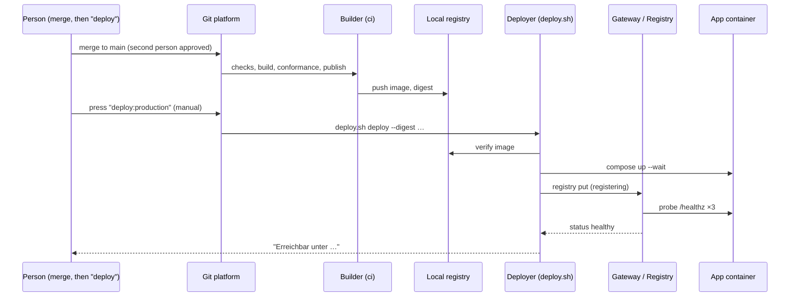

# 09 — Pipeline and Deploy

Implementation-level specification. Overview: `../09-component-design.md` §9. The Git platform is **undecided until 28.10.2026**; the pipeline is therefore specified platform-neutrally with a GitLab-flavoured reference definition (the Angebot names GitLab throughout) and a GitHub mapping in §9. ⚑ = confirm against the chosen platform and pinned tool versions.

## 1. Purpose and trust model

The pipeline turns a merge request into a running, registered app **without trusting the app's author with anything that matters**. The author controls: application code, tests, `manifest.json`, `README.md`. The author does **not** control: which checks run, how the image is built into a container, what the deploy step does, what the container is allowed to do.

Three consequences shape everything below.

1. **The pipeline definition is central and non-overridable** (§2, §9). App projects point their CI configuration at a file in the platform project.
2. **The pipeline never executes an author-controlled entry point for a security-relevant check** (R26). It calls tools directly with *central* configuration files. The `Makefile`, `pyproject.toml` tasks and `package.json` scripts are convenience for authors; the pipeline verifies that the managed ones are unchanged and does not depend on the owned ones for gates.
3. **Build and deploy are different users with different powers** (R8, §8). Build runs author code in a sandbox with no platform access. Deploy runs only the central `deploy.sh` and trusts nothing but an image digest and a schema-validated manifest.

What an author can still weaken, and why that is acceptable: the *content* of their tests (quality, not safety), the *content* of their README, application logic not covered by a rule. What an author cannot weaken: secret scan, manifest validation, lint rules, SDK integrity, container hardening, fail-closed behaviour (conformance probe), deploy behaviour.

## 2. Central pipeline definition (GitLab-flavoured reference) ⚑

`platform/pipelines/app-pipeline.yml`, referenced from each app project as CI/CD configuration file `app-pipeline.yml@platform/pipelines:v1`.

```yaml
stages: [secrets, manifest, integrity, lint, test, build, conformance, publish, deploy]

workflow:
  rules:
    - if: $CI_PIPELINE_SOURCE == "merge_request_event"
    - if: $CI_COMMIT_BRANCH == $CI_DEFAULT_BRANCH

default:
  tags: [portal-builder]
  interruptible: true
  before_script:
    - export PF_CATALOG=/opt/portal/pipelines/failure-codes.yml

variables:
  SLUG_FILE: manifest.json

secrets:
  stage: secrets
  script:
    - pf-run PF-102 -- gitleaks detect --source . --redact --no-banner --exit-code 1 --log-opts "${CI_MERGE_REQUEST_DIFF_BASE_SHA:-HEAD~1}..HEAD"

manifest:
  stage: manifest
  script:
    - pf-run PF-104 -- portal-manifest-check manifest.json --schema /opt/portal/schema/manifest.schema.json --openapi-dir /opt/portal/adapters/openapi --roles /opt/portal/roles-vocabulary.yml --scan-used-scopes .
  artifacts: { paths: [manifest.json], expire_in: 1 day }

integrity:
  stage: integrity
  script:
    - pf-run PF-103 -- sdk_verify --tree platform_sdk --releases /opt/portal/sdk-releases.json
    - pf-run PF-108 -- managed_files_verify --list /opt/portal/template-files.json
    - pf-run PF-107 -- forbid-strings --paths . --exclude platform_sdk --exclude .devcontainer --exclude tests --strings PORTAL_DEV

lint:
  stage: lint
  script:
    - pf-run PF-101 -- central-lint --config-dir /opt/portal/lint --rules /opt/portal/rules.json .

test:
  stage: test
  script:
    - pf-run PF-105 -- sandbox-run --image "$DEV_IMAGE" --ro "$CI_PROJECT_DIR" --rw build -- make test
  artifacts: { paths: [build/a11y], expire_in: 1 day }

build:
  stage: build
  script:
    - pf-run PF-109 -- podman build --format docker -t "build:$CI_COMMIT_SHA" .
    - pf-run PF-106 -- trivy image --severity CRITICAL --ignore-unfixed --exit-code 1 --no-progress "build:$CI_COMMIT_SHA"

conformance:
  stage: conformance
  script:
    - pf-run PF-110 -- conformance --image "build:$CI_COMMIT_SHA" --manifest manifest.json   # codes PF-110…PF-113 are emitted by the tool itself

publish:
  stage: publish
  rules: [{ if: '$CI_COMMIT_BRANCH == $CI_DEFAULT_BRANCH' }]
  script:
    - SLUG=$(jq -r .slug manifest.json)
    - podman push --digestfile digest.txt "build:$CI_COMMIT_SHA" "127.0.0.1:5000/apps/$SLUG:$CI_COMMIT_SHA"
  artifacts: { paths: [digest.txt, manifest.json], expire_in: 30 days }

deploy:stage:
  stage: deploy
  rules: [{ if: '$CI_COMMIT_BRANCH == $CI_DEFAULT_BRANCH', when: manual }]
  tags: [portal-deployer]
  needs: [publish]
  environment: { name: stage }
  resource_group: "stage-$CI_PROJECT_ID"
  variables: { GIT_STRATEGY: none }
  script:
    - deploy.sh deploy --env stage --digest "$(cat digest.txt)" --manifest manifest.json --owner "$CI_PROJECT_PATH" --by "$GITLAB_USER_LOGIN"

deploy:production:
  stage: deploy
  rules: [{ if: '$CI_COMMIT_BRANCH == $CI_DEFAULT_BRANCH', when: manual }]
  tags: [portal-deployer]
  needs: [publish]
  environment: { name: production }
  resource_group: "prod-$CI_PROJECT_ID"
  variables: { GIT_STRATEGY: none }
  script:
    - deploy.sh deploy --env prod --digest "$(cat digest.txt)" --manifest manifest.json --owner "$CI_PROJECT_PATH" --by "$GITLAB_USER_LOGIN"
```
Notes:
- Merge requests run every check up to `conformance`; only `main` publishes and offers the **manual** deploy jobs. Merging into `main` is itself manual and needs the second person (the four-eyes rule, Angebot §5.1/§6). This matches the client's 15.10 statement (*"Main ist Bildprozess bis Artifakt. Aber das Artifakt dann in den Container reinzuladen … ein expliziter Schritt"*).
- `GIT_STRATEGY: none` on deploy jobs: **no author file is ever checked out on the deployer.** Inputs are the two artifacts from `publish` (`digest.txt`, `manifest.json`), both re-validated by `deploy.sh`.
- `needs`/`resource_group` serialise deploys per project; `deploy.sh` additionally takes a per-slug file lock.
- `pf-run <CODE> -- <command>` is the wrapper described in §6: it runs the command, and on failure prints the German failure block for `<CODE>` plus the (redacted) tool output.

## 3. Stage details

| Stage | Runs as | Tool and behaviour | Fails with |
|---|---|---|---|
| **secrets** | `ci` | `gitleaks detect --redact` over the commit range (MR: diff base..HEAD; first pipeline of a project: full history) | PF-102 |
| **manifest** | `ci` | `portal-manifest-check`: JSON Schema (`03` §3), each `roles` entry ∈ role vocabulary, each `adapters` scope ∈ adapters' OpenAPI `x-required-scope`, declared scopes ⊇ scopes used by static scan of `portal.adapters.<system>.<op>` (R-SCHN-5), `slug` ≠ reserved. **Offline** (R24): slug ownership is checked later by the registry at deploy | PF-104 |
| **integrity** | `ci` | `sdk_verify` (hash against `sdk-releases.json`, `06` §10); `managed_files_verify` (R26: `Makefile`, `AGENTS.md`, `.agents/**`, `Dockerfile`, `.devcontainer/**`, `tools/**`, `.pre-commit-config.yaml` byte-identical to the starter version named in `.starter-version`); `forbid-strings` finds `PORTAL_DEV` in anything that ends up in the image or deploy config | PF-103, PF-108, PF-107 |
| **lint** | `ci` | `central-lint`: ruff/eslint/stylelint run with **central** config directories (not the repo's), rule scanners for R-DES-1…4, R-PORT-1, R-PORT-3, R-SCHN-1 (`08` §3), `ai-sync --check` | PF-101 |
| **test** | `ci`, **sandboxed** | `sandbox-run`: `podman run --rm --network=none --read-only --tmpfs /tmp` with the project mounted read-only and `build/` writable, in the DevContainer image; runs the author's `make test` (unit tests + structural axe). Author-supplied test code cannot touch the host or the network | PF-105 |
| **build** | `ci` | `podman build --format docker` (**`docker` format on purpose**: the OCI format drops the `HEALTHCHECK` instruction ⚑) with the verified `Dockerfile`; Trivy CRITICAL, unfixed ignored (`02-open-questions.md` §8 default: critical blocks, high warns) | PF-109, PF-106 |
| **conformance** | `ci` | §4 | PF-110…113 |
| **publish** | `ci` | push image tagged with the commit SHA to the local registry, record the **digest** | — |
| **deploy** | `deployer` | `deploy.sh` (§5) | PF-201…205 |

Timing budget: checks ≤ 8 min per merge request on the VM's builder; the slowest parts are image build and Trivy. Runner concurrency: 2 builder jobs.

## 4. Conformance probe (R6, R9, R27)

`conformance` (central Python program) answers one question: **does this image behave like a platform app when run the way production runs it?** It runs entirely under rootless Podman on an *internal* scratch network together with a central `jwks-stub` container that serves a test JWKS (`PORTAL_API_URL`) and signs test assertions with a test key.

Run configuration of the app container — identical to production hardening (`07` §10): `--user 10001:10001 --read-only --tmpfs /tmp --cap-drop ALL --security-opt no-new-privileges --memory 512m --cpus 0.5 --pids-limit 128`, environment `PORTAL_ENV=production PORTAL_SLUG=probe PORTAL_BASE_PATH=/apps/probe PORTAL_API_URL=http://jwks-stub:8001 PORTAL_ISSUER=https://probe.invalid/ PORTAL_PROBE=1`, a writable tmpfs at `/data`.

**`PORTAL_PROBE=1` (R27).** In this mode (accepted only together with `PORTAL_ENV=production`) the SDK's `install()` prints one JSON line on stdout at startup — `{"portal_probe":1,"routes":[["GET","/apps/probe/"],…]}` — listing every route the app registered. An app that never calls `install()` prints nothing, so **absence of the line fails the probe** (fail closed). The production compose template never sets `PORTAL_PROBE`; the pipeline's `forbid-strings` stage does not need to look for it because it only changes logging.

| # | Check | Pass condition | Code |
|---|---|---|---|
| C1 | Container becomes healthy | image `HEALTHCHECK` reports healthy within 30 s | PF-111 |
| C2 | HEALTHCHECK defined | `podman inspect` → `.Config.Healthcheck` non-empty | PF-113 |
| C3 | Route table present | startup line appears within 30 s | PF-110 |
| C4 | No assertion → 401 | for `/apps/probe/` and **every** route in the table (GET routes; others via OPTIONS/HEAD where meaningful) and 10 canary paths (`/`, `/admin`, `/api`, `/static/../`, …) | PF-110 |
| C5 | Self-signed assertion → 401 | token signed with an unknown key | PF-110 |
| C6 | Assertion for another slug → 401 | `aud` lacks `probe` | PF-110 |
| C7 | `alg: none` / HS256 → 401 | forged tokens | PF-110 |
| C8 | Valid assertion works | `/apps/probe/` returns 2xx with the right user shown (marker from the response) | PF-111 |
| C9 | `/healthz` open | 200 without assertion | PF-111 |
| C10 | No cookies | no `Set-Cookie` header in any response of the walk | PF-112 |
| C11 | Non-root | `podman top` / inspect user is uid 10001 | PF-113 |
| C12 | Runs read-only | healthy under `--read-only` (C1) | PF-113 |
| C13 | Stays alive | still healthy after the walk (no crash on malformed input: 3 oversized headers, 1 MB body to `/`) | PF-111 |

The scratch network is `internal`: an app that tries to reach out simply times out, and nothing in this probe depends on that. Network isolation of the real platform (Redis/gateway not reachable from `apps`) is verified separately by the **platform** test suite (`10-platform-ops.md` §9), because it is a property of the platform's networks, not of the image.

## 5. Publish, registry and `deploy.sh`

### 5.1 Local image registry

`registry:2` bound to `127.0.0.1:5000` (host loopback), htpasswd-protected, data in `/var/lib/portal/registry-images/`. Repositories `apps/<slug>`, tags = commit SHA, deployments always by **digest**. One registry serves stage and prod: **promotion is "deploy the same digest to prod that ran on stage" — no rebuild.** Credentials: push for `ci`, pull for `deployer` (files readable only by the respective user; the registry cannot enforce per-user ACLs, so both can technically push — accepted, noted).

Retention: keep the digests that are deployed or `previous` in either environment plus the last 5 per slug; `platform.sh gc-images` (weekly cron) removes older tags and runs the registry garbage collector ⚑ (needs `REGISTRY_STORAGE_DELETE_ENABLED=true`).

### 5.2 `deploy.sh` — behaviour

Location `/opt/portal/scripts/deploy.sh`, owned by root, executable only by `deployer`; **only** invoked by the deployer runner and by HKA-IT.

```text
deploy.sh deploy   --env <stage|prod> --digest <sha256:…> --manifest <file> --owner <repo> --by <user>
deploy.sh rollback --env <stage|prod> --slug <slug> --by <user>
deploy.sh retire   --env <stage|prod> --slug <slug> --by <user> [--purge-data --yes]
deploy.sh status   [--env <stage|prod>]

exit codes: 0 ok · 10 bad arguments · 11 manifest invalid · 12 image missing or not suitable
            13 another deploy holds the lock · 20 compose failed · 21 registry rejected
            22 not healthy, rolled back · 23 not healthy and rollback failed · 30 internal error
```
```text
deploy(env, digest, manifest, owner, by):
  1. exec 9>/var/lock/portal-$env-$slug.lock ; flock -n 9 || exit 13
  2. validate: env ∈ {stage, prod}; digest ~ ^sha256:[0-9a-f]{64}$; slug := manifest.slug ~ ^[a-z][a-z0-9-]{2,30}$       -> 10
  3. gateway-cli registry validate --manifest manifest --owner owner       (schema, roles, scopes, owner binding)   -> 11
  4. image check: registry lookup of 127.0.0.1:5000/apps/$slug@$digest (credentials of deployer);
        inspect: Healthcheck present, config.User == "10001:10001"                                                   -> 12
  5. prev := gateway-cli registry show $slug --json | .image_digest           (empty on first deploy)
  6. config env file: collect environment variables named ^APP_(SECRET|CONFIG)_[A-Z0-9_]+$ from the job;
        write /etc/portal/apps/$env/$slug.env.new (0600), atomically replace; if the job supplied none, keep the existing file
  7. render compose from template (07 §10) with strict variable checking -> /var/lib/portal/$env/apps/$slug/compose.yml
  8. docker compose -f … up -d --wait --wait-timeout 60                                                            -> 20
  9. gateway-cli registry put --slug --manifest --digest --owner --by          (state: registering)               -> 21
 10. poll gateway-cli registry get $slug every 2 s up to 90 s until status ∈ {healthy, failed}
 11. status == healthy:  append deployment (success); print "Erreichbar unter https://$host/apps/$slug/"; exit 0
 12. otherwise:
        if prev != "":  render compose for prev ; compose up -d --wait ; registry put --rollback ; print PF-201 ; exit 22 (23 if this also fails)
        else:           compose down ; registry retire ; print PF-201 ; exit 22
```
Properties: idempotent (re-running with the same digest converges); no step consults anything the author controls except `manifest.json` (re-validated) and the digest (checked); logs go to the CI job log and to `/var/log/portal/deploy.log` with `by`, `slug`, `digest`, exit code. The script never prints secret values.

`rollback` = steps 5–12 with `digest := previous successful digest from the registry's deployments table` and `--rollback` on the registry call — **one command, usable by HKA-IT** (Angebot §5.2: "setzt die App … mit einem Befehl auf die vorherige Version zurück"). `retire` = registry retire, `compose down`, optionally `docker volume rm` with `--purge-data --yes`.

### 5.3 Sequence



## 6. Failure-code catalog (feeds the `pipeline-fehler` skill)

The wrapper `pf-run` prints, for every failed job, a block in this exact shape (the AI and the person both read it; German, *einfache Sprache*, no jargon without explanation):

```text
============================================================
FEHLER PF-102  –  Geheimnis im Code gefunden
Was ist passiert:   In src/app/views.py (Zeile 12) steht etwas, das wie ein Schlüssel aussieht.
Warum wichtig:      Wer den Code sieht, könnte damit arbeiten.
Was tun:            1. Entfernen Sie den Schlüssel aus dem Code.
                    2. Er gilt als verbraucht – melden Sie ihn dem Plattform-Team, damit er ersetzt wird.
                    3. Mehr dazu: Skill „secrets".
Technische Details: (gekürzt, Werte geschwärzt)
  RuleID: generic-api-key  File: src/app/views.py  Line: 12
============================================================
```
Catalog (`pipelines/failure-codes.yml`; each entry has `title`, `what`, `why`, `todo`, `skill`):

| Code | Stufe | Titel | Was ist passiert | Was tun |
|---|---|---|---|---|
| PF-101 | lint | Regelverstoß im Code | Eine Regel der Plattform wurde verletzt (Datei und Zeile stehen in der Meldung). | Datei und Zeile öffnen, Regel lesen, korrigieren; lokal mit `make lint` prüfen. Skill zur Regel laden (`portal`, `schnittstellen`, `design`). |
| PF-102 | secrets | Geheimnis im Code gefunden | Im Code steht etwas, das wie ein Passwort oder Schlüssel aussieht. | Entfernen. Das Geheimnis gilt als verbraucht und muss ersetzt werden – Plattform-Team informieren. Skill `secrets`. |
| PF-103 | integrity | Portal-Bibliothek verändert | Der Ordner `platform_sdk/` stimmt nicht mit der freigegebenen Version überein. | `make sdk-update` ausführen; Änderungen daran sind nicht erlaubt. |
| PF-104 | manifest | `manifest.json` ungültig | Ein Feld fehlt, ist falsch oder nennt eine unbekannte Rolle oder Schnittstelle. | Die genannte Stelle korrigieren. Erlaubte Rollen und Rechte stehen in der Meldung. Skill `portal`. |
| PF-105 | test | Tests fehlgeschlagen | Mindestens ein automatischer Test ist rot. | `make test` lokal starten, den ersten roten Test ansehen und beheben. |
| PF-106 | build | Kritische Sicherheitslücke in einer Abhängigkeit | Ein verwendetes Paket hat eine bekannte, kritische Lücke. | Paket aktualisieren (`make lock`), dann erneut versuchen. Gibt es keine neue Version: Plattform-Team fragen. |
| PF-107 | integrity | Entwicklungsmodus in der Betriebs-Konfiguration | Der Text `PORTAL_DEV` steht in einer Datei, die in den Betrieb geht. | Entfernen. Der Entwicklungsmodus gehört nur in `.devcontainer/`. |
| PF-108 | integrity | Verwaltete Datei verändert | Eine Datei, die die Plattform pflegt (z. B. `Makefile`, `AGENTS.md`, `Dockerfile`), wurde geändert. | Änderung zurücknehmen oder `make template-update` ausführen. Eigene Ergänzungen gehören in `AGENTS.local.md`. |
| PF-109 | build | Container konnte nicht gebaut werden | Beim Bauen des Containers ist ein Schritt fehlgeschlagen. | Die erste Fehlerzeile der technischen Details lesen; `make docker` lokal ausführen. |
| PF-110 | conformance | App prüft die Anmeldung nicht | Die App hat eine Anfrage ohne Anmeldung beantwortet (oder `portal.install(app)` fehlt). | In `main.py`/`app.js` `portal.install(app)` vor allen Routen aufrufen. Skill `portal`. |
| PF-111 | conformance | App startet nicht oder wird nicht gesund | Der Container wurde nicht bereit, oder `/healthz` antwortet nicht. | Logs ansehen (`make docker`, dann Container starten); `/healthz` nicht verändern. |
| PF-112 | conformance | App setzt Cookies | Die App sendet `Set-Cookie`. Das ist im Portal nicht erlaubt. | Cookies entfernen; Zustand serverseitig speichern. |
| PF-113 | conformance | Container entspricht nicht den Betriebsregeln | Läuft als Administrator, hat keinen Gesundheitstest oder braucht Schreibrechte außerhalb von `/tmp` und `/data`. | `Dockerfile` nicht verändern (`PF-108`) oder Schreibzugriffe nach `/data` verlegen. |
| PF-201 | deploy | Bereitstellung zurückgesetzt | Die neue Version wurde nicht gesund und ist automatisch durch die vorherige ersetzt worden (oder entfernt, wenn es keine gab). | Technische Details lesen; Fehler beheben; erneut bereitstellen. Die App ist weiterhin in der alten Version erreichbar. |
| PF-202 | deploy | Registrierung abgelehnt | Die Plattform lehnt die App ab (anderer Besitzer für diesen Namen, Version zu alt, unbekannte Rolle). | Meldung lesen; bei „Besitzer" das Plattform-Team fragen. |
| PF-203 | deploy | Zurücksetzen fehlgeschlagen | Auch die vorherige Version ist nicht gesund. | **Sofort das Plattform-Team benachrichtigen.** Nichts weiter versuchen. |
| PF-204 | deploy | Bereitstellung gesperrt | Eine andere Bereitstellung dieser App läuft gerade. | Einige Minuten warten, dann erneut starten. |
| PF-205 | deploy | Container-Abbild nicht gefunden oder nicht geeignet | Das veröffentlichte Abbild fehlt in der Ablage oder hat keinen Gesundheitstest bzw. den falschen Benutzer. | Pipeline für den Hauptzweig erneut laufen lassen (Stufe „publish"); bleibt es dabei, Plattform-Team informieren. |

Mapping from `deploy.sh` exit codes to catalog: 11 → PF-202, 12 → PF-205, 13 → PF-204, 20 and 22 → PF-201, 21 → PF-202, 23 → PF-203. The `pipeline-fehler` skill (`08` §3.6) instructs the AI to look the code up in this table (shipped to the starters as `docs/fehlercodes.md`, generated from `failure-codes.yml`) instead of paraphrasing the tool output.

## 7. Secrets and per-app configuration: the request process (R18)

Authors hold the *Developer* role: they can push branches and open merge requests but **cannot create or read CI/CD variables**. That is deliberate — secrets stay out of reach of the people (and AIs) who write code — and it needs a human process:

1. The AI (skill `secrets`) tells the author which name the code expects, e.g. `APP_SECRET_KALENDER_TOKEN`, and links the request form (an issue template **"Secret/Konfiguration anfragen"** in the platform project: app slug, variable name, purpose, environment, how the value will be delivered).
2. The author gives the value to the platform maintainer **out of band** (not in the issue, not in chat).
3. A maintainer sets the project variable: *masked*, *protected* (only `main`), *environment scope* `stage` or `production`.
4. The author (or maintainer) triggers the deploy job again. `deploy.sh` writes `/etc/portal/apps/<env>/<slug>.env` from the job's `APP_SECRET_*`/`APP_CONFIG_*` variables (step 6).
5. The maintainer closes the issue; the variable name (never the value) is listed in the app's README by the author.

Non-secret configuration (`APP_CONFIG_*`, e.g. a test recipient address) follows the same route for symmetry; it is simply not masked. Secrets for the **platform itself** (OIDC client secret, signing keys) are not CI variables at all: they live in `/etc/portal/secrets/<env>/` and are created by `platform.sh bootstrap`.

## 8. Runners, users and permissions

| Item | Specification |
|---|---|
| Unix users | `ci` (no sudo, no docker group), `deployer` (docker group — equivalent to root on the VM, which is why its job set is minimal), one human admin group `portal-admins` for HKA-IT |
| Builder | GitLab Runner (shell executor) as `ci`, tags `portal-builder`, concurrency 2, rootless Podman (`subuid`/`subgid` ranges, `loginctl enable-linger ci`); tests run through `sandbox-run` in a throw-away container; builds run `podman build` rootless |
| Deployer | GitLab Runner (shell executor) as `deployer`, tags `portal-deployer`, **`locked`, `run_untagged=false`, `protected=true`** (only protected refs), concurrency 1, registered only for the platform's project group |
| Secrets visible to | `ci`: none. `deployer`: `/etc/portal/apps/**` (write), registry pull credential; **not** the OIDC client secret or signing keys (those are readable only by root and by the containers via Docker secrets) |
| Registry token for the gateway CLI | read inside the gateway container only; `deploy.sh` reaches the registry through `docker compose exec` (R24) |
| Who may press *deploy* | users allowed to merge to the protected default branch (maintainers + HKA-IT) ⚑ — GitLab Free offers this through protected branches; *protected environments* with explicit approver lists are a higher tier |
| Branch rules | default branch protected: no direct push, merge only by a different person than the author (approval rule "1 approval, author may not approve" ⚑ tier-dependent); CI file path locked by project settings |

If HKA offers shared runners, the builder moves there and only the deployer remains on the VM; the pipeline definition does not change.

## 9. Versioning, GitHub mapping, notifications

- **Pipeline versions:** the central file is tagged `v1`, `v1.1`, …; app projects pin `@v1` (major). Backwards-compatible fixes ship under the moving `v1` tag; a breaking change is `v2` with a migration note. A platform script (`tools/set-ci-path.py`) updates `ci_config_path` for all app projects through the Git platform's API (token held by the platform team).
- **GitHub mapping ⚑:** *required workflows* via organisation rulesets reference the central workflow; jobs map 1:1 (`gitleaks-action`, custom actions for the central tools); protected environments `stage`/`production` with required reviewers replace the "who may merge" rule; self-hosted runners with the same two-user split. If the plan tier lacks required workflows, fall back to CODEOWNERS on `.github/workflows/` plus branch protection, and record the weaker guarantee in the risk list.
- **Notifications (optional):** failure and deploy results posted to the team's Matrix room (the team already coordinates by Matrix, 15.10 recording) by a `notify` step in the deployer/builder using a bot token held as a protected variable. Not part of the Angebot; low cost.
- **Audit trail:** `deploy.log`, the registry `deployments`/`audit` tables and the Git platform's job log together answer "who deployed what, when".

## 10. Tests

| # | Case |
|---|---|
| PL1 | Clean reference app (Python and Node): all stages green; `deploy:stage` succeeds; app visible in the stage menu |
| PL2 | Planted key → PF-102 with redacted output; MR blocked |
| PL3 | Modified `platform_sdk/` byte → PF-103; modified `Makefile` → PF-108; `PORTAL_DEV` in `compose` file → PF-107 |
| PL4 | Manifest with unknown role / unknown scope / reserved slug → PF-104 naming the field |
| PL5 | App that never calls `install()` → PF-110; app that answers 200 to an unauthenticated `/admin` → PF-110; app that sets a cookie → PF-112; app running as root or without HEALTHCHECK → PF-113 |
| PL6 | Author edits `.gitlab-ci.yml` locally and pushes → ignored (central path); author tries to change the CI path setting → denied (Developer role) |
| PL7 | A test file that tries to read `/etc/portal` or reach the network → fails inside `sandbox-run`, host untouched |
| PL8 | `deploy.sh` with an unhealthy new image → exit 22, previous version still served, menu unchanged, PF-201 printed |
| PL9 | First deploy of an unhealthy app → app removed, exit 22 |
| PL10 | Two concurrent deploys of one slug → second exits 13 |
| PL11 | `deploy.sh rollback` after a successful second deploy restores the first digest; registry shows `rollback` deployment |
| PL12 | `deploy.sh retire --purge-data --yes` removes route, container and volume; without `--yes` aborts |
| PL13 | Job log scan: no secret value, assertion or token appears |
| PL14 | Same digest deployed to stage then prod: no rebuild occurs; digests identical in both registries' records |
| PL15 | Deployer runner refuses an unprotected branch pipeline |
| PL16 | Failure-code blocks: every code in `failure-codes.yml` renders; every code emitted by a tool exists in the catalog (static cross-check) |

## 11. Open points

- Platform choice (28.10) fixes §2 syntax, the exact "non-overridable" mechanism, and whether Secret Push Protection exists (`../03-proposal-review.md` finding 17).
- Who presses the manual deploy button and who sits in `portal-admins` (HKA-IT vs. team) — `../09-component-design.md` §14 item 4.
- Whether production deployment should require a prior successful stage deployment of the same digest (recommended; one registry query; not enforced in the first version).
- ⚑ Podman rootless on the HKA VM's OS version, `--format docker` HEALTHCHECK retention, GitLab Runner executor choice, registry garbage-collection settings.
