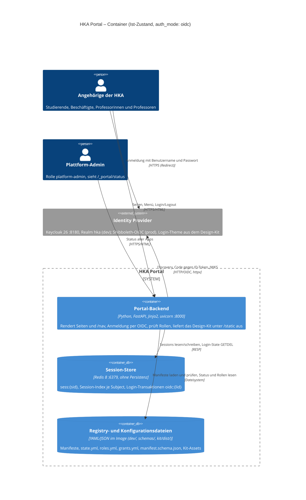

# 08 – C4-Modell: Container (Level 2)

Container des Portals im jetzigen Stand, wie `make server-up` sie startet (`extras/compose/server`). Bausteine, die es
noch nicht gibt (Traefik, SQLite-Registry, Prober, echte Apps), stehen unter [Noch nicht im Diagramm](#noch-nicht-im-diagramm).

## Container

| Container | Technik | Aufgabe | Quelle |
|---|---|---|---|
| Portal-Backend | Python, FastAPI, Jinja2, uvicorn; Image aus `Dockerfile.trixie` | Seiten (`/`, `/_portal/*`), Menü-Fragment `/nav`, Anmeldung (`/login`, `/oidc/callback`, `/logout`), `/readyz`, Fehlerseiten, Kit-Assets unter `/static` | `src/portal/`, `extras/compose/backend/` |
| Session-Store | Redis 8 (`redis:8-alpine`), speichert nichts auf Platte | Sessions mit Idle- und Absolut-Timeout, Login-Transaktionen (State, Nonce, PKCE-Verifier) | `auth/redis_sessions.py`, `extras/compose/redis/` |
| Registry- und Konfigurationsdateien | Dateien im Backend-Image, kein eigener Prozess | App-Manifeste, Status je App, Rollenzuordnung, Schema, gebautes Kit | `dev/`, `schemas/`, `kit/dist/` |
| Identity Provider (extern) | Keycloak 26 mit Realm `hka` und Login-Theme `hka` | Authorization Code mit PKCE, ID-Token, RP-initiated Logout | `extras/compose/keycloak/` |

## Beziehungen

- **Browser → Backend:** HTML-Seiten und Formulare, Session-Cookie `portal_sid`, beim Login zusätzlich `portal_login`.
- **Browser → IdP:** Redirect zur Anmeldung und zur Abmeldung (`end_session_endpoint`); der Browser erreicht Keycloak als
  `localhost:8180`.
- **Backend → IdP:** Discovery, Token-Endpunkt und JWKS über `keycloak:8080` im Compose-Netz (`oidc.discovery_url`); der
  `issuer` bleibt `http://localhost:8180/realms/hka` (siehe [05 Compose](05-compose.md#hostnamen-von-keycloak)).
- **Backend → Redis:** `redis_url`; fällt Redis aus, antwortet `/readyz` mit 503.
- **Backend → Dateien:** Registry-Snapshot aus `manifests_dir`, im Dev-Modus bei jeder Anfrage auf Änderungen geprüft
  (siehe [07 Registry und Apps](07-registry-und-apps.md)).

## Variante `auth_mode: dev`

Mit `make dev` läuft nur das Backend auf dem Host: Testpersonen aus `dev/users.yml` statt IdP, Sessions im Speicher
(ohne `redis_url`), dazu Platzhalter-Seiten unter `/apps/<slug>/`. Redis und IdP fallen aus dem Diagramm weg.

## Noch nicht im Diagramm

| Baustein | Jetzt | Vorgabe |
|---|---|---|
| Reverse Proxy | Browser spricht das Backend direkt an | Traefik mit `/auth/verify` und `errors`-Middleware (`claude-proposal/02-gateway.md`) |
| Registry | Dateien in `dev/manifests/` | SQLite-Registry (`claude-proposal/03-registry.md` §2) |
| Status | `dev/state.yml` | Prober im Gateway (03 §7) |
| Apps | Platzhalter-Seite `/apps/<slug>/` | eigene Container hinter Traefik, `/nav` mit Identity-Assertion auf :8001 |
| Adapter-Service | – | `claude-proposal/05-adapter-service.md` |
